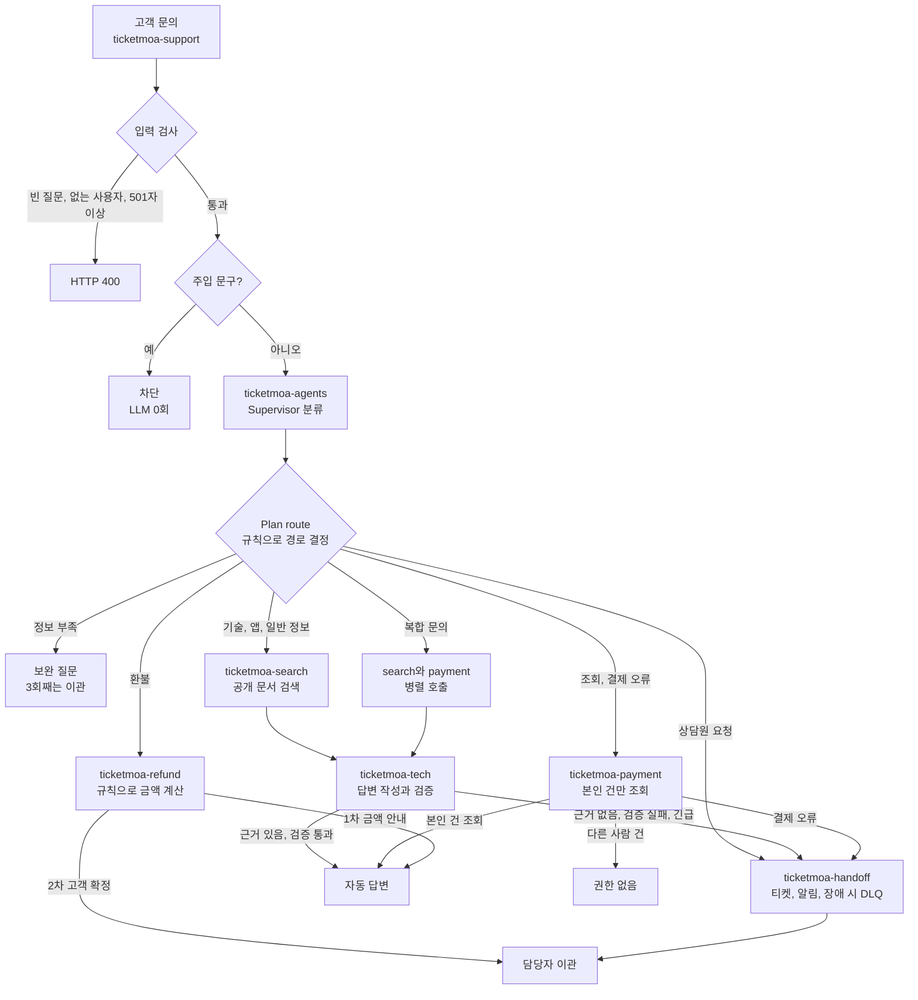
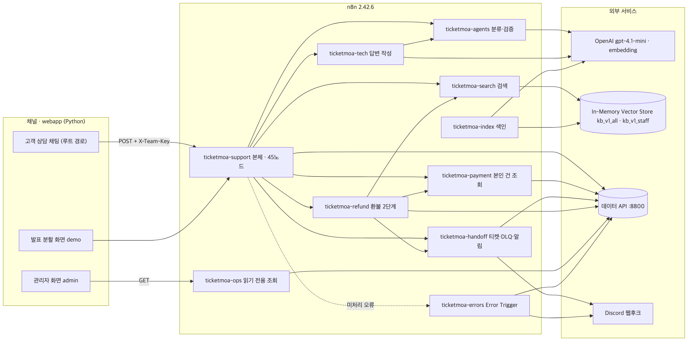
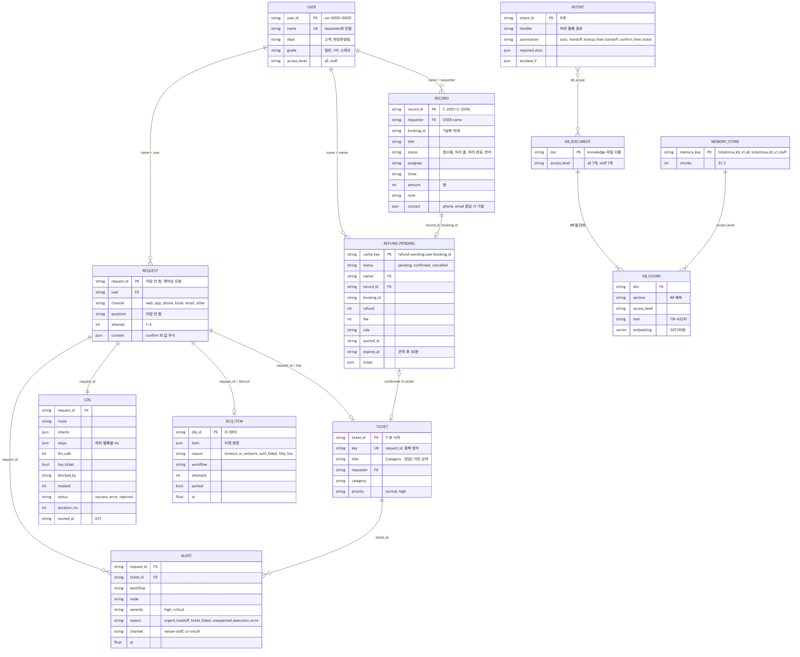

# 티켓모아 · 고객 기술지원 멀티에이전트 (n8n)

가상의 온라인 티켓 예매 기업 **티켓모아**의 고객센터로 들어오는 기술 문의를 처리하는 n8n 멀티에이전트 워크플로우입니다. 문의를 자동으로 분류하고, 지식 문서(RAG)와 예매 기록을 근거로 답합니다. 해결이 어렵거나 사람의 승인이 필요한 건은 요약해 상담원 티켓으로 넘깁니다.

- 팀: 티켓모아 · 최두나(리드·통합) · 최강현(오케스트레이션) · 정예진(RAG) · 심환석(연동·안정성) · 김인혜(시험·품질)
- 기간: 2026-11-05 ~ 2026-11-09 (제출 11/09 14:50, `main` 마지막 커밋)
- 스택: n8n 2.42.6, OpenAI gpt-4.1-mini, text-embedding-3-large, In-Memory Vector Store, 연습용 데이터 API
- 입구: `POST /webhook/ticketmoa-support` (Header `X-Team-Key` → [Header Auth](#header-auth-팀-키))

## 주제

공연 직전에 QR이 안 뜨거나 결제가 두 번 되면 고객은 바로 답을 기다립니다. 그런데 이런 문의에는 문서만 보고 바로 답할 수 있는 건과, 본인 확인이나 사람의 승인이 필요한 건이 섞여 있습니다. 티켓모아는 이 둘을 나눠 처리합니다.

- **답할 수 있는 문의는 근거와 함께 바로 답합니다.** 문서에 없는 내용은 지어내지 않고 이관합니다.
- **돈과 개인정보는 규칙으로 지킵니다.** 환불은 고객이 확정한 뒤 티켓으로만 넘기고, 다른 사람의 예매는 보여 주지 않습니다.
- **장애가 나도 응답을 멈추지 않습니다.** 하위 시스템이나 LLM이 실패하면 담당자 이관으로 답합니다.

### 응답 다섯 가지

| route | 뜻 | 예시 |
| --- | --- | --- |
| `자동 답변` | 문서나 본인 기록을 근거로 바로 답함 | "모바일티켓 QR이 회색으로만 나오고 안 떠요" |
| `보완 질문` | 정보가 부족해 되물음 (3회째는 이관) | "어제부터 계속 안 돼요" |
| `담당자 이관` | 요약 티켓을 만들어 상담원에게 넘김 | 지식 문서에 없는 문의, 공연 10분 전 입장 문제 |
| `권한 없음` | 본인 건이 아니어서 알려 주지 않음 | 다른 사람의 문의 번호 조회 |
| `차단` | LLM을 부르기 전에 규칙으로 막음 | 프롬프트 주입 문구 |

빈 질문, 없는 사용자, 501자 이상 질문은 route 없이 HTTP 400으로 거절합니다.

### 처리하는 문의

| 문의 유형 | 처리 | 근거 |
| --- | --- | --- |
| 모바일티켓·입장 장애 | 자동 답변. 공연 30분 이내 입장 문제는 긴급 이관과 현장 알림 | `mobile-ticket-troubleshooting`, `onsite-entry-fallback` |
| 앱·계정 오류 | 자동 답변 | `app-login-troubleshooting` |
| 공연장 이용 정보 | 자동 답변 | `venue-faq` |
| 예매·문의 조회 | 본인 건만 자동 답변, 다른 사람 건은 권한 없음 | 예매 기록 조회 |
| 결제 오류 | 조회 후 항상 이관 | `payment-error-guide` |
| 부정 예매 제한 | 사유는 자동 답변, 이의 신청은 이관 | `fair-booking-policy` |
| 암표 신고 | 항상 이관 | `fair-booking-policy` |
| 환불 | 1차 금액 안내, 고객 확정 후 환불 요청 티켓 | `refund-policy` |
| 상담원 요청 | 항상 이관 | — |
| 지식 문서에 없는 문의 | 검색 후 근거가 없으면 이관 | 검색 결과 |

### 자동으로 답하지 않는 경우

- 환불 확정이나 결제 취소처럼 돈이 움직이는 처리: 에이전트가 실행하지 않고, 고객 확정 뒤 상담원에게 넘깁니다.
- 환불 예정액 30만원 초과, 관람일 전날 17시 이후, 공연 당일 취소 요청
- 강한 부정 감정, 상담원 연결을 직접 요청한 경우
- 현장 스태프 전용 절차를 묻는 요청: 로그인이 없어 직원을 증명할 수 없으므로 `staff-entry-manual`은 누구도 검색하지 못합니다. 담당자에게 넘깁니다.

## 전체 흐름

걸러낼 수 있는 요청은 LLM을 부르기 전에 끝냅니다. 규칙으로 정할 수 있는 것은 규칙으로 처리하고, LLM은 분류·답변·검증에만 씁니다.



위 그림은 주요 경로만 보여 줍니다. 강한 불만과 공연 당일 취소 문의는 관련 문서를 찾은 뒤 이관합니다. 모든 응답은 나가기 전에 `/logs`에 기록을 남기며, 기록에는 질문 원문과 연락처를 넣지 않습니다. 노드 단위 흐름은 [워크플로우 설계서](docs/WORKFLOW-DESIGN.md)에 있습니다.


### 환불 2단계

환불은 금액을 잘못 안내하거나 고객 뜻과 다르게 접수되면 안 되므로 두 번에 나눠 처리합니다.

1. **1차 요청:** 규칙으로 예상 금액을 계산해 안내합니다. 이때는 티켓을 만들지 않습니다.
2. **2차 요청:** 같은 사용자, 같은 예매, 30분 안의 견적이고 `context.confirm`이 `true`일 때만 환불 요청 티켓을 만듭니다. 실제 취소는 상담원이 합니다.

### 안전장치

| 장치 | 동작 |
| --- | --- |
| 팀 키 | 본체 웹훅은 Header Auth로 막혀 있고, 키가 없거나 틀리면 403 |
| 권한 | 문의는 요청 `user`와 기록 `requester`가 일치할 때만 답하고, 공개 경로에서 직원 저장소를 검색하지 않음. 로그인이 없어 다른 사람 이름을 입력하는 사칭은 막지 못함 |
| 근거 검증 | 검증 Agent가 근거·정책·개인정보를 확인하고, 통과하지 못하면 이관 |
| 부정 사용 차단 | 가상 IP 정책과 반복 요청(같은 사용자·같은 질문 60초에 6번째)을 LLM 앞에서 차단. 기록 조회가 실패하면 막지 않고 통과 |
| 개인정보 | 응답과 로그에서 연락처를 가리고 가린 개수는 `security.masked`에 표시 |
| 장애 대응 | 하위 웹훅이 실패해도 HTTP 200 + `{"error"}`로 돌려주고, 본체가 이관으로 처리 |
| 티켓 장애 | `ticket: null`로 답하고 DLQ와 알림을 남김 |
| 재시도 | 429·5xx·timeout만 재시도하고, 401·403은 재시도하지 않음 |
| 중복 방지 | 티켓 `key`에 `request_id`를 넣어 같은 요청은 같은 티켓을 돌려줌 |

## 워크플로우



웹앱(고객 채팅, 발표 분할 화면)은 팀 키(`X-Team-Key`)를 붙여 본체 `ticketmoa-support`만 부르고, 관리자 화면은 읽기 전용 `ticketmoa-ops`만 부릅니다. AI(OpenAI)는 `agents`·`tech`와 색인·검색의 임베딩에서만 쓰고, 기록·티켓·DLQ·알림은 데이터 API에 남깁니다. 처리되지 않은 오류는 `ticketmoa-errors`가 받아 데이터 API와 디스코드로 알립니다.

하위 워크플로우는 Execute Workflow가 아니라 HTTP Request로 웹훅을 부릅니다.

| 파일 | 웹훅 경로 | 노드 | 하는 일 | 담당 |
| --- | --- | --- | --- | --- |
| `ticketmoa-support` | `ticketmoa-support` | 45 | 본체: 입력 검사, 주입·부정 사용 차단, 라우팅, 병렬 호출, 응답 조립, 기록 | 최두나 |
| `ticketmoa-agents` | `ticketmoa-agents`, `ticketmoa-agents-verify` | 17 | Supervisor 분류, 보완 질문 판단, 답변 검증 | 최강현 |
| `ticketmoa-refund` | `ticketmoa-refund` | 38 | 환불 금액 안내, 고객 확정 후 티켓 | 최강현 |
| `ticketmoa-index` | `ticketmoa-index` | 12 | 지식 문서 검사, `##` 절 단위 청킹, 권한별 색인 | 정예진 |
| `ticketmoa-search` | `ticketmoa-search` | 13 | 권한별 메모리 키 검색 | 정예진 |
| `ticketmoa-tech` | `ticketmoa-tech` | 17 | 근거 기반 답변 작성, 공연 직전 대체 입장 안내 | 정예진 |
| `ticketmoa-payment` | `ticketmoa-payment` | 11 | 본인 예매·문의 조회, 연락처 가림 | 심환석 |
| `ticketmoa-handoff` | `ticketmoa-handoff` | 33 | 요약 티켓, 중복 방지, 재시도, DLQ, 알림 | 심환석 |
| `ticketmoa-errors` | 없음 (Error Workflow) | 9 | 오류 정보 정규화, 중복 판정, `/alerts`·디스코드 동시 알림 | 심환석 |
| `ticketmoa-ops` (가산) | `ticketmoa-ops` | 6 | 티켓·알림·DLQ·로그·장애 설정 읽기 전용 조회 | 심환석 |

## 데이터 구조 (ERD)



실제 DB 없이 연습용 데이터 API(`data/`, `/tickets`, `/alerts`, `/dlq`, `/logs`, `/cache`)와 n8n In-Memory Vector Store에 나뉘어 저장됩니다. 로그인이 없어 테이블 사이는 `user_id`가 아니라 **이름**(`USER.name` = `RECORD.requester` = `REQUEST.user`)으로 이어집니다.

| 묶음 | 엔터티 | 저장 위치 |
| --- | --- | --- |
| 사용자·기록 | `USER` 5명, `RECORD` 6건(C-2001~C-2006) | `data/users.json`, `data/records.json` |
| 요청 처리 | `REQUEST`(저장하지 않음, 웹훅 계약), `LOG`, `TICKET`(`key` = `request_id`로 중복 방지), `DLQ_ITEM`, `ALERT` | 데이터 API `/logs`, `/tickets`, `/dlq`, `/alerts` |
| 환불 | `REFUND_PENDING` (견적 30분, 고객 확정 시 티켓) | 데이터 API `/cache` |
| 업무·문서 | `INTENT` 9개, `KB_DOCUMENT` 8개(all 7, staff 1), `KB_CHUNK` 42개(3,072차원), `MEMORY_STORE` 2개(`ticketmoa_kb_v1_all` 37, `ticketmoa_kb_v1_staff` 5) | `config/registry.json`, `knowledge/`, n8n 메모리 |

- 질문 원문과 연락처 원문은 저장하지 않습니다. `LOG`에는 단계와 시간, 가린 개수(`masked`)만 남습니다.

## 현재 상태

2026-11-07 18:33~18:43 KST, **팀 VM**에 지식 문서 42청크로 색인하고 예열한 뒤 시험한 결과입니다. 보고서는 `runs/vm/`에 있고, 모든 시험의 버전과 환경은 `docs/EXECUTION-RESULT.md` 0절(T행)에 있습니다. **예열 후 한 회차의 전체 통과이며, 같은 워크플로우의 예열 없는 S행은 공통 50/51입니다.**

| 시험 | 결과 |
| --- | --- |
| 공통 시나리오 (`cases/common.json`) 3회 | 51/51 |
| 팀 시나리오 (`cases/team.json`) 1회 | 13/13 |
| 보안 시나리오 (`cases/security-permissions.json`) 1회 | 8/8 |
| 정상 문의 `bench -n 5` | p50 5.61초, p95 6.59초, 실패 0/5 |

- **WF-01:** 예열 뒤 5.3 / 5.2 / 5.5초로 3/3이지만 첫 예열 호출은 8.8초였습니다. 예열 없는 재시작 후 첫 호출은 9.9초, 7.4초, 7.9초, 8.0초였습니다. 예열하면 첫 호출 지연은 사라지지만(측정 4.80~5.76초) 모델 응답 변동은 남아 간헐 지연은 미결입니다.
- **사칭:** 로그인이 없어 요청의 `user`는 본인 확인이 아닙니다. 내 이름으로 남의 건은 볼 수 없지만, 다른 사람 이름을 입력하면 그 사람의 건이 조회됩니다(가짜 데이터, 연락처는 가림).
- **재색인 직후:** 첫 공개 검색이 `index_unavailable`일 수 있어, 재색인 뒤 잠시 기다렸다가 시연합니다.

### 11/09 재시험 (팀 VM, 각 1회)

11/09 오전 운영 Error Workflow 확인 뒤 팀 VM에서 다시 돌린 결과입니다. 각 1회 실행이라 위 T행(공통 3회)과 합산하지 않습니다. 자세한 조건은 `docs/EXECUTION-RESULT.md`의 U행에 있습니다.

| 시험 | 시각 (KST) | 결과 | 보고서 |
| --- | --- | --- | --- |
| 공통 시나리오 (`cases/common.json`) | 09:13 | 14/17. 티켓 API 고장 스위치가 켜진 채 시작해 WF-02b·WF-03 티켓 없음, WF-01 9.2초 | `runs/vm/u-faulton-common-20261109-001300.json` |
| 공통 시나리오 (`cases/common.json`) | 09:16 | **17/17** (`fault all ok` 뒤 재시험) | `runs/vm/u-recheck-common-20261109-001605.json` |
| 팀 시나리오 (`cases/team.json`) | 10:34 | **13/13** | VM `runs/team-20261109-013404.json` (저장소 미보관) |

팀 시나리오 13개의 기대와 11/09 결과입니다.

| 시나리오 | 확인하는 것 | 기대 | 시간 |
| --- | --- | --- | --- |
| TM-01 앱 로그인 | 우리 업무 유형의 정상 답변 | 자동 답변 | 7.8초 |
| TM-02 환불 1차 | 금액만 안내, 티켓 없음 | 자동 답변, `ticket: null` | 3.0초 |
| TM-03 환불 2차 | 고객 확정 뒤에만 환불 요청 티켓 | 담당자 이관 | 0.7초 |
| TM-04 상담원 연결·점검 시간 문의 | 지나치게 막지 않음 | 차단 없음 | 2.1초 |
| TM-05 이중결제 + 부정 감정 | 강한 불만은 사람에게 | 담당자 이관 | 2.4초 |
| TM-06 관람 당일 취소 | 규칙 경계(당일 취소 불가) | 담당자 이관 | 2.2초 |
| TM-13 환불 30만 원 초과 | 금액 한도 규칙 | 담당자 이관 | 3.5초 |
| TM-07 매크로 제한 문의 | 제한 사유 안내 | 자동 답변 | 6.0초 |
| TM-08 암표 신고 | 보안팀으로 이관 | 담당자 이관 | 1.9초 |
| TM-09 반복 요청 6번째 (가산) | 같은 질문 반복을 LLM 앞에서 차단 | 차단 (`rate_limit`) | 0.2초 |
| TM-10 해외 IP (가산) | 가상 IP 정책 | 차단 (`geo`) | 0.2초 |
| TM-11 블랙리스트 IP (가산) | 가상 IP 정책 | 차단 (`ip_blocklist`) | 0.2초 |
| TM-12 국내 IP (가산) | 과잉 차단 없음 | 자동 답변 | 5.5초 |

- TM-01은 7.8초로 통과했지만 8초 기준에 가깝습니다. AI 응답 시간 변동은 위 WF-01과 같은 미결 문제입니다.
- TM-09 앞의 5번 요청(각 약 4초)은 차단 한도를 채우기 위한 사전 호출이며 결과에 세지 않습니다.

## 디렉터리

```
aio-01-p4-team4/
├── README.md                  # 이 파일 (주제·흐름·실행 방법·시연 순서)
├── AGENTS.md                  # 코딩 에이전트 규칙 (모두 먼저 읽기)
├── CLAUDE.md                  # @AGENTS.md
├── .env.example               # 환경 변수 이름만 (값은 .env에, git에 올리지 않음)
│
├── workflows/                 # n8n JSON, 한 사람 = 한 파일, 키 없음
│   ├── ticketmoa-support.json     # 최두나
│   ├── ticketmoa-agents.json      # 최강현
│   ├── ticketmoa-refund.json      # 최강현
│   ├── ticketmoa-index.json       # 정예진
│   ├── ticketmoa-search.json      # 정예진
│   ├── ticketmoa-tech.json        # 정예진
│   ├── ticketmoa-payment.json     # 심환석
│   ├── ticketmoa-handoff.json     # 심환석
│   ├── ticketmoa-errors.json      # 심환석
│   └── ticketmoa-ops.json         # 심환석 (가산)
│
├── knowledge/                 # 지식 문서 8개 (staff-entry-manual만 스태프 전용)
├── data/                      # users.json 5명, records.json 6건 (가짜 데이터)
├── config/
│   ├── registry.json          # 업무 레지스트리 9개 (Supervisor 프롬프트 재료)
│   └── ip-policy.json         # 가상 IP 국가·블랙리스트 (가산, TM-10~12)
├── lib/
│   ├── common.js              # 공통 함수 원본 (Code 노드에 복사해서 씀)
│   ├── README.md              # 함수 목록·누가 어디서 쓰나
│   └── test/common.test.js
│
├── cases/                     # common.json(공통 14유형 17케이스), team.json(팀 13개, TM-09~12는 가산)
├── requests/                  # 시연·bench용 요청 파일
├── runs/                      # 결과서 증거로 남길 test·bench 보고서 (vm/은 팀 VM 결과, 파일 이름 시각은 UTC)
│
├── security/                  # 환불 안전장치 원본, promptfoo 회귀 시험, PyRIT 설계 예시
├── reference/                 # 색인·검색 출발 예제 워크플로우
├── tools/
│   ├── flow.py                # 78일차 flow.py를 부르고 팀 웹훅에 X-Team-Key를 붙임
│   ├── reindex.py             # knowledge/를 다시 색인하고 검색 확인 (push 뒤 실행)
│   ├── demo.py                # 발표 시연: 시나리오 요청을 보내고 결과를 표시
│   └── register-team-key.sh   # 팀 키와 데이터 API 키 Credential을 고정 id로 등록
│
└── docs/
    ├── TOPIC.md               # 주제 제안서
    ├── PLAN.md                # 기획서
    ├── IMPLEMENTATION-PLAN.md # 구현 순서·역할·하위 웹훅 계약
    ├── PROMPTS.md             # 역할별 바이브코딩 프롬프트
    ├── TEAM-CHARTER.md        # 팀 헌장
    ├── TODO.md                # 교시별 일정
    ├── WORKFLOW-DESIGN.md     # 산출물 1: 워크플로우 설계서
    ├── RAG-ARCHITECTURE.md    # 산출물 2: RAG 설계서
    ├── EXECUTION-RESULT.md    # 산출물 3: 실행 결과서
    ├── daily/                 # 데일리 기록 80·81·82
    └── images/                # 기획 구조도, 오케스트레이션 구조도, 시스템 구성도, ERD
```

## 처음 받은 사람

작업은 **Windows 로컬**에서 하고, 실행·검증은 **서버 `aio-t4`의 `~/aio-01-p4-team4`**에서 한다. SSH 키와 `aio-t4` 접속 설정은 팀에서 받은 `SETUP_PROMPT.md`로 먼저 끝낸다. 서버 주소·포트·비밀번호는 이 저장소 어디에도 적지 않는다.

**1. 로컬에 받기 (PowerShell)**

```powershell
git clone https://github.com/ensk712-rgb/aio-01-p4-team4.git
cd aio-01-p4-team4
git switch test                         # 통합 브랜치에서 시작
git switch -c feat/<이름>-<파일>        # 예: feat/jeongyejin-search
node --test lib/test/*.test.js          # 공통 함수 테스트 (전부 통과해야 함)
ssh -o BatchMode=yes aio-t4 "whoami"   # toor가 나오면 서버 접속 준비 끝
```

**2. 서버에 반영하고 실행**

내 워크플로우를 시험할 때는 **내 파일만** 올린다.

```powershell
scp workflows/<내 파일>.json aio-t4:~/aio-01-p4-team4/workflows/
ssh aio-t4 "bash -lc 'cd ~/aio-01-p4-team4 && uv run tools/flow.py check workflows/<내 파일>.json && uv run tools/flow.py push workflows/<내 파일>.json && sleep 10 && uv run --env-file .env tools/reindex.py && sleep 5 && uv run --env-file .env tools/demo.py --warm'"
```

전체 배포는 리드가 `main` 기준으로 한다.

```powershell
scp -r workflows knowledge data cases config lib requests tools aio-t4:~/aio-01-p4-team4/
ssh aio-t4 "bash -lc 'cd ~/aio-01-p4-team4 && uv run tools/flow.py push workflows/*.json && sleep 10 && uv run --env-file .env tools/reindex.py && sleep 5 && uv run --env-file .env tools/demo.py --warm'"
```

- **`push`는 공용 n8n을 다시 켠다.** 한 사람이 올려도 팀 전체의 실행이 끊기고, In-Memory 색인이 사라질 수 있다. 그래서 올리기 전에 팀 채팅에 알리고, 올린 뒤에는 `tools/reindex.py`로 색인을 다시 돌린다. 이 스크립트는 OpenAI 임베딩을 호출한다.
- 서버에는 78일차 `flow.py`가 기본 경로에 없다. `FLOW_PY=~/aio-tools/Last3Mon/78/tools/flow.py`를 붙여 실행한다. 보고서는 `~/aio-tools/Last3Mon/78/runs/`에 저장되므로, 결과서에 쓸 보고서는 `runs/vm/`으로 옮긴다.
- 서버 명령은 꼭 `bash -lc`로 감싼다 (없으면 `uv`를 못 찾는다). PowerShell에서 명령 안에 `$`가 있으면 `` `$ ``로 쓴다.
- 오래 걸리는 시험은 서버 `tmux` 세션에서 돌린다. 서버 RAM이 2.6GB라 n8n과 같이 쓰므로 무거운 작업 전에 `free -h`를 본다.
- 서버에서 파일을 직접 고치지 않는다. 다음 `scp` 때 로컬 파일로 덮어써진다.
- 서버의 `~/n8n/day65-n8n`과 n8n 컨테이너는 건드리지 않는다. `.env`가 필요하면 `scp`로 따로 옮기고 git에는 올리지 않는다.

**3. 서버 폴더는 하나뿐이다**

서버 계정과 `~/aio-01-p4-team4` 폴더, n8n을 다섯 명이 같이 쓴다. 각자 아무 때나 `scp`하면 서로의 파일을 덮어쓰고 같은 웹훅 경로가 부딪친다. 그래서:

- 자기 하위 워크플로우는 **자기 파일만** 올려서 시험한다 (`scp workflows/ticketmoa-search.json aio-t4:~/aio-01-p4-team4/workflows/`).
- 공통 폴더(`knowledge/`, `data/`, `cases/`, `lib/`)는 PR이 `main`에 병합된 뒤 리드가 `main` 기준으로 올린다.
- 반영 전에 팀 채팅에 "지금 올립니다"를 한 줄 남긴다.

**4. PR**

```powershell
git add workflows/ticketmoa-search.json
git commit -m "search: 권한 필터 뒤 검색"
git push -u origin feat/<이름>-<파일>
```

GitHub에서 `test`로 PR을 열면 리드가 검토하고 병합한다. 리드가 `test`에서 공통 시나리오를 돌려 확인한 뒤 `test` → `main` PR로 올린다. 다음 작업 전에는 `git switch test; git pull`로 최신을 받는다.

**n8n에서 손으로 할 것**: Credential 3개(`OpenAI (.env)`(id `openAiCourse0001`, `Last3Mon/65/n8n/register-credentials.sh`로 등록), `ticketmoa-data-api`(X-Api-Key), `ticketmoa-team-key`(X-Team-Key)) 만들기, 워크플로우 활성화. 색인은 `uv run --env-file .env tools/reindex.py`로 넣는다. OpenAI Credential은 새로 만들지 말고 등록 스크립트가 만든 것을 고른다 (WF-10 시험이 이 Credential의 키를 잠깐 깨뜨려 확인한다). 키 값은 n8n Credentials에만 둔다.

## 시험

```bash
uv run tools/flow.py push workflows/*.json
sleep 10
uv run --env-file .env tools/reindex.py && sleep 5 && uv run --env-file .env tools/demo.py --warm
uv run --env-file .env tools/flow.py test cases/common.json --webhook ticketmoa-support -v
uv run --env-file .env tools/flow.py test cases/team.json -v
```

- **push 뒤 10초쯤 기다렸다가 색인하고 시험한다.** `push`는 n8n을 다시 켜는데, 직후 몇 초 동안은 이전 버전이 응답해서 결과가 틀리게 나온다.
- **`knowledge/`를 고친 뒤에도 `tools/reindex.py`를 돌린다.** 색인에는 마지막으로 보낸 문서만 들어 있다.
- **하위 웹훅이 없거나 멈추면 본체는 `담당자 이관`으로 답한다** (fail-closed. 하위 웹훅 timeout 5초, 예매 조회는 2.5초, 이관은 남은 시간 예산 `5.5초 - 쓴 시간`으로 끊고 같은 값을 `deadline_ms`로 넘긴다). 그래서 내 하위 웹훅을 아직 올리지 않았어도 본체 시험은 500 없이 돈다.
- 시험 도중 바뀐 장애 스위치·OpenAI 키는 시험이 끝나면 되돌아간다. 중간에 멈췄으면 `uv run tools/flow.py fault all ok`, `uv run tools/flow.py llm up`.

### 실행 기록 보기

본체는 응답 직전에 데이터 API `POST /logs`로 한 줄을 남긴다 (기록이 실패해도 응답은 그대로 나간다). 질문 원문·답변·사용자 이름·연락처는 남기지 않는다.

```bash
curl -s 'http://localhost:8800/logs?source=live'     # 오늘 남은 기록
curl -s -X POST http://localhost:8800/logs-reset     # 시험 전에 비우기
```

| 칸 | 내용 |
| --- | --- |
| `request_id`, `route`, `intents` | 요청 번호, 최종 경로, 분류 결과 |
| `steps` | 하위 웹훅별 걸린 시간 ms (`agents_ms`, `search_ms`, `payment_ms`, `tech_ms`, `refund_ms`, `handoff_ms`) |
| `llm_calls`, `has_ticket`, `ticket` | LLM 호출 수, 티켓 여부, 티켓 번호 |
| `blocked_by`, `masked` | 차단한 곳(`rule`), 가린 연락처 수 |
| `status`, `duration_ms`, `started_at` | `success` · `error`(하위 웹훅 실패로 이관) · `rejected`(400), 전체 시간, 한국 시간 (77일차 보고서가 읽는 칸) |

### Header Auth (팀 키)

본체 웹훅은 Header Auth(`X-Team-Key`)로 막혀 있다. **키 없이 부르거나 틀린 키로 부르면 403**(`Authorization data is wrong!`)이 맞다 (n8n Header Auth는 401이 아니라 403을 돌려준다). 팀 키는 `openssl rand -hex 16`처럼 영문·숫자로 만든다 (한글이 섞이면 헤더로 보낼 수 없어 맞는 키도 403이 된다). 키 값은 저장소·문서·채팅에 쓰지 않는다. `cp .env.example .env && chmod 600 .env`로 만든 `.env`의 `TM_TEAM_KEY`에만 넣는다 (`.env`는 git에 올라가지 않는다). 시험(`tools/flow.py`)과 Credential 등록(`tools/register-team-key.sh`)이 모두 이 한 이름을 읽는다.

1. 최신 `main`을 받는다: `git pull origin main` (`tools/register-team-key.sh`, 팀 키 id를 허용하는 `tools/flow.py`가 들어 있다).
2. 각자 노트북(n8n이 있는 곳)에서 한 번 실행해 팀 키 Credential을 고정 id `ticketmoaTeamKey1`로 넣는다:
   ```bash
   set -a; . ./.env; set +a; bash tools/register-team-key.sh
   ```
3. 확인:
   ```bash
   uv run tools/flow.py check workflows/ticketmoa-support.json
   uv run tools/flow.py push workflows/ticketmoa-support.json
   uv run --env-file .env tools/flow.py test cases/common.json --webhook ticketmoa-support
   ```

`Question webhook` 노드는 `"authentication": "headerAuth"`와 `"credentials": {"httpHeaderAuth": {"id": "ticketmoaTeamKey1", "name": "ticketmoa-team-key"}}`를 쓴다. 다른 id로 Credential을 새로 만들면 다른 팀원 n8n에서 JSON이 돌지 않는다.

## 시연 순서 (발표)

조합 A: 팀 VM에서 요청을 보내고 n8n 실행 화면을 함께 보여 준다. 웹 화면(가산)은 쓰지 않는다.

```bash
cd ~/aio-01-p4-team4
uv run --env-file .env tools/demo.py --warm    # 시연 전 예열. 재시작 뒤 첫 호출의 지연을 예열 호출이 대신 낸다. 쉬고 난 뒤 첫 요청도 느리거나 이관될 수 있다
uv run --env-file .env tools/demo.py --pause   # 전체, 단계마다 Enter
```

1. WF-13 입력 거절 400  2. WF-08 주입 차단 LLM 0회  3. WF-07 본인 건 조회, 연락처 가림  4. WF-06 남의 건 거절
5. WF-01 QR 문의 → 분류·검색·검증·근거  6. WF-12 공연 10분 전 → 대체 입장 + 긴급 티켓 + 현장 알림  7. TM-10 해외 IP 차단 (가산)

`tools/demo.py`는 팀 키를 화면에 쓰지 않는다. 시연 화면에서 `.env`를 열지 않는다. VM이 응답하지 않으면 `docs/EXECUTION-RESULT.md` 0절과 `runs/vm/` 보고서로 설명한다.
