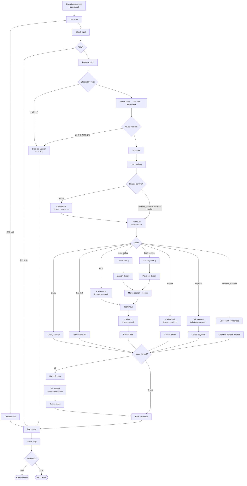

# 노코드 워크플로우 설계서 · 티켓모아

> 산출물 ① (35점 제안). 강의 자료 「기술지원자동화_전체아키텍처」 23쪽 목차 8절을 따른다.
> 담당: 1절 A 최두나 · **2~4절 B 최강현** · 5~7절 D 심환석 · 8절 함께.
> 노드 이름은 `workflows/*.json`의 실제 노드 이름이다. 파일에 노드가 남아 있어도 현재 연결로 도달하지 못하면 "과거 경로"로 적는다.
> 상태: 1절 갱신 (2026-11-06, A) · 2~4절 초안 (2026-11-04, B, 본체와 tech 노드는 A가 실제 파일에 맞춤). 5~8절 초안 (2026-11-04, A 작성). 2~8절은 2026-11-06 A가 디스코드·ops·최신 지연 판정을 실제 파일과 대조해 고쳤고, 담당자 재확인 전이다. 2026-11-07 A가 `main` `a85bcd3`의 연결과 Code 노드를 다시 대조해 페이로드·오류 처리·도달 불가 경로 표시를 고쳤다. 같은 날 개인 조회 복구에 맞춰 2~7절을 다시 고쳤다. 실행 예시(4.6절)의 표는 로컬 n8n 결과이고, 팀 VM 결과는 4.6절 끝에 따로 적었다.

**프로젝트 범위:** TicketMoa는 상용 예매 서비스 전체가 아니라 AI Agent와 n8n으로 기업 기술지원 문의를 분류·처리하고, RAG·업무 분기·상담 이관·오류 처리를 검증하는 프로젝트다. 회원가입·로그인·세션·개인 사용자 인증은 의도적으로 제외했다. 공개 안내와 기술지원에 더해 수업 시나리오의 본인 문의 조회와 환불 2단계를 제공하고, 직원 전용 문서 검색은 제공하지 않는다. 로그인이 없어 요청의 `user`는 본인 확인이 아니다. 기록의 `requester`와 일치해야 조회되므로 내 이름으로 남의 건은 볼 수 없지만, 다른 사람 이름을 입력하는 사칭은 막지 못한다. 데이터는 모두 가짜이고 연락처는 가려서 답한다. 최신 전체 결과는 실행 결과서 T행이다.


### 과거 최종 배포본 인수 기록 (11/06 당시) · WF-02/02b·11·12

VM에 반영해 시험한 파일은 `test` 커밋 `90f02ca`와 같고, 이 커밋은 PR #42로 `main` 병합 커밋 `ceef5d8`에 포함됐다. 아래 결과는 그 시점 배포본 기준이며, 이후 배포 결과는 결과서를 따른다.

| 항목 | 최종 동작 | VM 결과 |
| --- | --- | --- |
| WF-02 (`attempt: 1`) | 정보 부족·저신뢰이면 필요한 화면·메시지·공연일·예매번호를 묻고 `보완 질문` | **3/3**, 1.5 / 2.1 / 1.6초 |
| WF-02b (`attempt: 3`) | 최대 횟수에서는 분류 LLM을 호출하지 않고 이관 | **3/3**, 1.3 / 0.6 / 0.6초, `llm_calls: 0`, 같은 요청은 `T-2035` 재사용 |
| WF-11 | 본인 조회 API가 8초 지연되면 조회 예산 안에서 끊고 실패를 숨기지 않은 채 이관·DLQ·장애 알림 | **3/3**, 5.7 / 5.6 / 5.6초(6초 기준) |
| WF-12 | 긴급 QR 검색과 본인 문의 조회를 병렬 실행해 합침 | 당시 **3/3**, 3.8 / 4.4 / 3.9초. T행 **3/3**, 4.0 / 3.7 / 3.8초. 현장 발권 근거, C-2002 상태, high 티켓 확인 |

보완 질문의 `attempt`는 서버가 같은 HTTP 요청 안에서 증가시키는 값이 아니다. 웹·앱 어댑터가 첫 요청을 1로 보내고, 고객 답을 받아 다시 호출할 때 2, 3으로 1씩 증가시킨다. `attempt < 3`은 계속 보완 질문할 수 있고 `attempt >= 3`은 `clarify_limit_reached`로 종료·이관한다. 요청의 `attempt`가 1 미만이거나 정수가 아니면 입력 오류다.

WF-12에서 search는 공개용 고객 인덱스를 조회하고 payment는 요청 `user`와 `record_id=C-2002`를 data-api에 보내 requester 일치를 확인한다. 요청의 `user`는 호출자의 신원을 증명하지 않는다(사칭 한계). 11/06~07 비로그인 일괄 차단 기간(P·Q·R행)의 WF-12는 조회 없는 이관이었고 11/07 복구로 위 동작이 돌아왔다. 한쪽 실패를 다른 쪽 결과로 성공처럼 덮지 않는다.

근거: [당시 공통 회귀 51/51](../runs/vm/wf01-fix-common-20261106-025239.json), [배포 파일 해시·시험 조건](../runs/vm/wf01-fix-metadata-20261106-025239.json). 이후 전체 회귀와 선택 개인정보 차단 시험은 `EXECUTION-RESULT.md`에 회차별로 구분해 기록한다.

시험 회차별 결과는 [`EXECUTION-RESULT.md`](EXECUTION-RESULT.md) 맨 앞 절과 0절에 모은다. WF-01 간헐 지연은 미결이다.

## 1. 업무 시나리오 · 처리할 문의 유형

### 1.1 업무 시나리오

가상의 온라인 티켓 예매 기업 티켓모아의 고객센터로 모바일티켓, 앱, 결제 오류, 입장 장애, 환불 문의가 들어온다. 이 워크플로우는 공개 지식 문서를 바탕으로 문의를 자동 분류·답변하고, 해결이 어렵거나 사람의 승인이 필요한 건은 요약해 상담원 티켓으로 넘긴다. 요청의 `user` 이름으로 예매·문의 기록도 조회하며, 기록의 `requester`와 일치하는 본인 건만 연락처를 가려 답하고 남의 건은 거절한다 (11/07 팀 결정으로 복구). 로그인이 없어 `user`가 신원을 증명하지는 않으므로 다른 사람 이름을 입력하는 사칭은 막지 못한다 (5절).

고객은 `POST /webhook/ticketmoa-support`로 질문을 보내고, 다음 다섯 가지 중 하나로 답을 받는다.

| route | 뜻 | 대표 시나리오 |
| --- | --- | --- |
| `자동 답변` | 문서나 본인 기록을 근거로 바로 답함 | WF-01 "모바일티켓 QR이 회색으로만 나오고 안 떠요" |
| `보완 질문` | 정보가 부족해 되물음 (3회째는 이관) | WF-02 "어제부터 계속 안 돼요" |
| `담당자 이관` | 요약 티켓을 만들어 상담원에게 넘김 | WF-03 지식 문서에 없는 문의, WF-12 공연 10분 전 입장 문제 |
| `권한 없음` | 본인 건이 아니어서 알려 주지 않음 (`not_owner`) | WF-06 남의 문의 번호 상태 조회 |
| `차단` | LLM을 부르기 전에 규칙으로 막음 | WF-08 프롬프트 주입 |

로그인이 없어 요청의 `user`는 본인 확인이 아니다. 기록의 `requester`와 일치해야 조회되므로 내 이름으로 남의 건은 볼 수 없지만, 다른 사람 이름을 입력하는 사칭은 막지 못한다. 데이터는 모두 가짜이고 연락처는 가려서 답한다.

잘못된 입력(빈 질문, 없는 사용자, 501자 이상)은 route 없이 HTTP 400으로 거절한다 (WF-13).

### 1.2 처리할 문의 유형

업무 레지스트리(`Load registry`)의 9개 업무와, 어디에도 속하지 않는 문의를 다음과 같이 처리한다.

| 문의 유형 | intent_id | 예시 | 처리 | 근거 |
| --- | --- | --- | --- | --- |
| 모바일티켓·입장 장애 | `tech_issue` | QR이 안 떠요, 게이트 인식 실패 | 자동 답변. 공연 30분 이내 입장 문제는 긴급 이관 + 현장 알림 | `mobile-ticket-troubleshooting`, `onsite-entry-fallback` |
| 앱·계정 오류 | `account_issue` | 로그인 반복, 인증 문자 미수신 | 자동 답변 | `app-login-troubleshooting` |
| 공연장 이용 정보 | `general_info` | 주차, 입장 시간 | 자동 답변 | `venue-faq` |
| 예매·문의 조회 | `booking_lookup` | C-2002 어떻게 됐어요? | 본인 건만 자동 답변, 남의 건은 권한 없음 | 예매 기록 조회 |
| 결제 오류 | `payment_error` | 이중결제, 결제됐는데 예매 없음 | 조회 후 항상 이관 | `payment-error-guide` |
| 부정 예매 제한 | `fair_booking` | 매크로 의심 제한, 해외 접속 차단 | 사유는 자동 답변, 이의 신청은 이관 | `fair-booking-policy` |
| 암표 신고 | `scalping_report` | 웃돈 판매 신고 | 항상 이관 | `fair-booking-policy` |
| 환불 | `refund_request` | 취소하면 얼마 돌려받아요? | 1차 금액 안내 → 고객 확정 후 환불 요청 티켓 | `refund-policy` |
| 상담원 요청 | `human_request` | 상담원 연결해 주세요 | 항상 이관 | — |
| 등록 업무 아님 | (없음) | 제휴 카드 포인트 적립 | 명확한 미등록 업무는 검색·추측 답변 없이 이관 | 업무 레지스트리 |
| 의도 불분명 | (없음) | 어제부터 계속 안 돼요 | 보완 질문, 3회째 이관 | — |

### 1.3 자동으로 답하지 않는 경우

- 돈이 움직이는 처리: 에이전트는 환불이나 결제 취소를 실행하지 않고, 고객 확정 뒤 상담원 티켓으로만 넘긴다.
- 환불 예정액 30만원 초과, 관람일 전날 17시 이후, 공연 당일 취소 요청
- 강한 부정 감정, 고객이 상담원 연결을 직접 요청한 경우
- 지식 문서에 근거가 없는 질문
- 현장 스태프 전용 절차를 묻는 공개 요청: 로그인이 없어 직원을 증명할 수 없으므로 직원 전용 검색은 제공하지 않는다(11/07 리드 확정). 책임자 코드·수기 모드 등 내부 절차는 공개 답변하지 않고 제한·이관한다. 요청의 직원 주장은 권한 근거가 아니다.

### 1.4 데이터

| 데이터 | 개수 | 위치 |
| --- | --- | --- |
| 지식 문서 | 8개 (일반 7, 스태프 전용 1) | `knowledge/` |
| 사용자 | 5명 (일반 3, VIP 1, 현장 스태프 1) | `data/users.json` |
| 예매·상담 기록 | 6건 (C-2001~C-2006) | `data/records.json` |

모든 데이터는 가짜이며 연락처는 `010-0000-xxxx`, `@example.com` 형식이다. 외부 시스템은 연습용 데이터 API만 쓴다.

### 1.5 가산 차단과 시험 기준

- **가산 차단:** 반복 요청과 IP 차단(`rate_limit`, `geo`, `ip_blocklist`, TM-09~11)은 `support`의 주입 차단 뒤, LLM 앞에 연결했다. IP는 실제 접속 주소가 아니라 요청의 `context.client_ip`(가상 IP)로 검사한다.
- **가산 웹 화면·운영 조회:** 시연용 웹 화면 `webapp/`은 고객 채팅(`/`), 관리자(`/admin`), 발표 분할 화면(`/demo`)을 제공한다. `ticketmoa-ops`는 티켓·알림·DLQ·로그·장애 설정을 읽기 전용으로 조회한다. 11/05 구현 기록의 확인 환경은 로컬이고 이후 팀 VM에도 Docker로 올렸으며, 시험 보고서는 없다. 둘 다 공통·팀 시나리오 통과 수치에 포함하지 않는다.
- **WF-05 팀 기존 자동검사 기준(수업 공통 기준과 다름):** `cases/common.json`의 기대 결과를 따른다. 일반 고객의 응답 `sources`에 `staff-entry-manual`이 없고, 답에 `책임자 코드`, `수기 모드`가 없으면 통과다. route는 정하지 않으므로, 고객용 문서로 답하거나 이관하는 것 모두 허용한다. 수업 기준은 route `권한 없음` 또는 `담당자 이관`을 요구하므로 팀 검사 PASS를 수업 기준 통과로 세지 않는다. `b77b0e8` 배포는 실제 route가 `자동 답변` 1회, `담당자 이관` 2회로 수업 기준 2/3이었다(`runs/vm/tm-main-common-20261106-061717.json`). 보완본은 `Plan route`의 `staff_only_request` 규칙으로 3/3이다(`runs/vm/security-review-20261106-062701.json`). 시험한 표현과 대조군 기준이며, 다른 표현은 검색 권한 분리와 답변 검증이 계속 막는다.

## 2. 전체 흐름 (단계 목록)

강의 자료 7쪽의 "문의 하나가 지나가는 8단계"에 맞췄다. 규칙으로 정할 수 있는 것은 규칙으로, AI는 뜻을 판단해야 할 때만 쓴다.

| 단계 | 하는 일 | 종류 | 워크플로우 · 노드 | 기준값 |
| --- | --- | --- | --- | --- |
| 1 받기 | 웹훅으로 질문 도착, 팀 키 확인 | 규칙 | support `Question webhook` (Header Auth `X-Team-Key`) | — |
| 2 입력 검사 | 빈 질문 · 501자 이상 · 없는 사용자 → 400 | 규칙 | support `Get users` → `Check input` → `Valid?` (실패하면 `Log record` → `Rejected?` → `Reject invalid`). 사용자 조회 실패는 `Lookup failed` | 500자, users 5명 |
| 3 문지기 | 주입 문구, IP 정책, 반복 요청 차단 | 규칙 | support `Injection rules` → `Blocked by rule?` → `Abuse rules` → `Get rate` → `Rate check` → `Abuse blocked?` → `Save rate`. 차단이면 `Blocked answer` | 주입 패턴, 가상 IP 정책, 같은 사용자·같은 질문 60초에 6번째 (lib/common.js) |
| 4 분류 | 업무 유형 · 긴급도 · 감정 · 빠진 정보 | AI | support `Load registry` → `Refund confirm?` → `Call agents` → **agents** `규칙 신호 추출` → `LLM 필요?` → `Supervisor 분류` → `분류 결과 검사` → support `Plan route` → `Route` | 확신도 0.7, 긴급 = 공연 30분 이내 |
| 5 검색 | 지식 문서를 찾고, 복합 문의는 내 접수 건도 함께 | 검색 | support `Call search` → `Tech input`. 복합 문의: `Call search ∥` → `Search done ∥`, `Call payment ∥` → `Payment done ∥` → `Merge search + lookup` → `Tech input` | top_k는 RAG 설계서. 점수 기준은 아직 없음 (4.7절) |
| 6 답변 | 찾은 근거로만 답 쓰기 | AI / 규칙 | 기술·앱·일반: support `Call tech` → **tech** `처리 준비` → `공연 직전?` → `근거 있음?` → `작성 시간 있음?` → `답변 작성` → `작성 결과 검사` → `작성 통과?` → support `Collect tech`. 환불: `Call refund` → **refund** 규칙 문장 → `Collect refund`. 조회·결제: `Call payment` → `Collect payment` | 근거 없으면 이관 |
| 7 검증 | 근거 · 정책 · 개인정보 다시 확인 | AI | tech `검증 시간 있음?` → `검증 호출` → **agents-verify** `검증 프롬프트 조립` → `검증할 내용 있음?` → `검증 Agent` → `검증 결과 검사` → tech `답변 결정` | 셋 다 true여야 통과 |
| 8 갈림길 · 기록 | 답 또는 이관, 기록 남기기, 응답 | 규칙 | support `Needs handoff?` → `Handoff input` → `Call handoff` → `Collect ticket` → `Build response` → `Log record` → `POST /logs` → `Rejected?` → `Send result`. DLQ와 알림은 handoff가 처리 | 기록에 질문 원문·연락처 없음 |

환불은 4단계에서 갈라져 `ticketmoa-refund`로 간다. 1차 요청은 금액만 안내하고(ticket null), 2차 요청은 `Refund confirm?`이 `context.pending_action`과 boolean `context.confirm`을 확인해 분류 LLM 없이 바로 보낸다. 같은 사용자·같은 예매·30분 안의 견적이고 `confirm === true`일 때만 환불 요청 티켓을 만든다. 실제 취소는 상담원이 한다. 당일 취소 문의(`signals.show_day`)는 `Call search (evidence)` → `Evidence handoff answer`로 규정 근거를 찾아 이관한다. 강한 불만 문의도 같은 경로로 해당 업무 문서(레지스트리 `kb_scope`)를 찾아 이관한다. 긴급 문의(`urgency=high`)는 `Call search`와 `Call search ∥`가 `scope`를 `onsite-entry-fallback`으로 좁혀, 검색 순위와 상관없이 대체 입장 근거를 받는다.

## 3. 흐름도 · 워크플로우 파일 표

### 3.1 흐름도

강의 자료 8쪽처럼 윗줄은 걸러내기, 아랫줄은 답 만들기다. 걸러진 요청은 AI를 부르기 전에 끝난다.


구조도 원본: `images/orchestration.html` (인쇄용 `images/orchestration.pdf`). 청록 = AI, 흰 상자 = 규칙, 점선 칩 = 비상구, 빨간 테두리 = B 보안 장치.

> 구조도 이미지는 주요 노드만 묶어 보여 준다.
>
> 아래 그림의 `Route` 갈래는 11/07 개인 조회 복구 뒤 현재 연결과 같다. 일괄 차단 기간(P·Q·R행)에는 `tech_lookup`, `refund`, `payment` 갈래가 `Handoff answer`로 갔다.



이 그림은 본체 `ticketmoa-support`의 흐름이다. 답변 작성과 검증(`ticketmoa-agents-verify` 호출)은 `Call tech` 안쪽의 tech에서 일어난다.

### 3.2 워크플로우 파일 표

| 파일 | 웹훅 | 하는 일 | 담당 | 부르는 곳 · 시간 제한 |
| --- | --- | --- | --- | --- |
| `ticketmoa-support.json` | `/webhook/ticketmoa-support` | 본체: 1~3단계, 라우팅, 병렬, 8단계 | A | — |
| `ticketmoa-agents.json` | `/webhook/ticketmoa-agents` | 분류 (Supervisor) | B | support `Call agents` 5초 |
| 〃 | `/webhook/ticketmoa-agents-verify` | 검증 Agent | B | tech `검증 호출` 남은 시간 (0.5~5초) |
| `ticketmoa-refund.json` | `/webhook/ticketmoa-refund` | 환불 2단계 확인 | B | support `Call refund` 5초 |
| `ticketmoa-index.json` | `/webhook/ticketmoa-index` | 색인 | C | 수동 |
| `ticketmoa-search.json` | `/webhook/ticketmoa-search` | 공개 문서 검색; 직원 전용 검색은 제공하지 않음 | C | support `Call search` 5초, `Call search (evidence)` 2초 |
| `ticketmoa-tech.json` | `/webhook/ticketmoa-tech` | 기술·앱·일반 답변, 대체 입장 | C | support `Call tech` 5초 (안쪽 `작성 모델` 3.2초) |
| `ticketmoa-payment.json` | `/webhook/ticketmoa-payment` | 본인 건 조회, 남의 건 forbidden | D | support `Call payment`·`Call payment ∥` 2.5초, refund 4초 |
| `ticketmoa-handoff.json` | `/webhook/ticketmoa-handoff` | 요약 티켓 · 알림 · DLQ | D | support `Call handoff` 최대 5.5초에서 경과 시간을 뺀 값 (최소 0.5초), refund 5초 |
| `ticketmoa-errors.json` | Error Trigger | 오류 알림 (`/alerts`, 디스코드) | D | support, agents, refund, payment, handoff, ops의 Error Workflow (7.3절) |
| `ticketmoa-ops.json` (가산) | `/webhook/ticketmoa-ops` | 티켓·알림·DLQ·로그·장애 설정 읽기 전용 조회 | D | `webapp/` 관리자 화면. 내부 `데이터 API 읽기` 5초 |

support에서 `Call handoff`만 요청 시작부터 지난 시간을 빼서 시간 제한을 계산하고, 나머지 호출은 위 고정값을 쓴다. `deadline_ms`는 하위 웹훅에 넘기는 남은 시간(ms)이다. 하위 웹훅은 실패해도 HTTP 200 + `{"error": ...}`로 돌려주고, 부르는 쪽은 오류 출력 갈래에서 이관으로 간다.

## 4. 역할 카드 · 분기 · 병렬 · 루프

### 4.1 역할 카드 (AI 직원 3명 + 문지기)

강의 자료 9쪽의 역할 나누기를 따른다. AI 결과는 JSON으로 받고 Code가 읽는다. 읽지 못하면 안전한 쪽(담당자 이관)으로 보낸다.

| 역할 | 노드 | 하는 일 | 결과물 | 하지 않는 일 | 못 읽으면 |
| --- | --- | --- | --- | --- | --- |
| 분류 triage | agents `Supervisor 분류` (gpt-4.1-mini, 반복 1회) | 업무 유형 · 긴급도 · 감정 · 빠진 정보 | `{intents[], entities{record_id, booking_id}, sentiment, urgency, confidence, clarity, missing[], clarify_question}` | 답하지 않기. 질문은 `<question>` 안 데이터로만 | `분류 결과 검사` → intents [] · confidence 0 → 이관 |
| 답변 writer | tech `답변 작성` (gpt-4.1-mini, 반복 1회) | 검색한 근거로만 답 쓰기 | `{answer, grounded}` → 답 + sources | 근거 밖 내용 · 약속 | `작성 결과 검사` → `작성 실패 결과` → 이관 |
| 검증 verifier | agents `검증 Agent` (gpt-4.1-mini, 반복 1회) | 근거 안의 답인지, 정책(환불 실행 주장 없음), 개인정보 | `{relevant, grounded, policy_ok, issues}` → `{ok, issues}` | 답을 새로 쓰지 않기 | `검증 불가 결과` ok false → 이관 |
| 문지기 guard | support `Injection rules` (규칙) | 공격 문구 판별 | `{blocked, blocked_by, reason}` | 답하지 않기 | — (규칙이라 항상 읽힘) |

문지기는 강의 자료에서 선택 항목이다. 우리 팀은 AI 대신 규칙으로 두어 LLM 호출 0회로 막는다 (WF-08). AI는 환불의 금액·한도·확정을 정하지 않는다. refund의 Code 노드가 정한다.

### 4.2 분기

| 분기 노드 | 조건 | 갈래 | 기준값 |
| --- | --- | --- | --- |
| support `Refund confirm?` | `pending_action = refund_request`이고 `context.confirm`이 boolean이면 분류 없이 `Plan route`로, 아니면 `Call agents`로 | 2갈래 | — |
| support `Plan route` (decideRoute) → `Route` | 사용자와 무관하게 내부 절차 요청 → 이관 (`staff_only_request`) / 환불 확정 context → refund / 분류 실패 → 이관 (`agents_failed`, `agents_unreadable`) / human_request → 이관 / angry → 관련 문서가 있으면 evidence_handoff, 없으면 이관 / 뜻은 분명한데 등록 업무 없음 → 이관 / intents 없음 · 확신도 미달 · missing → 보완 질문, attempt ≥ 3이면 이관 / 환불 + 당일 신호 → evidence_handoff / 그 외 → 업무별 처리 | clarify · handoff · tech · tech_lookup · refund · payment · evidence_handoff 7갈래 | 확신도 0.7, 최대 3회 |
| agents `LLM 필요?` | `!statusOnly && attempt < 3`이면 Supervisor, 아니면 `규칙 분류 결과` (상태만 묻는 문의 → booking_lookup, attempt ≥ 3 → intents [] · confidence 0 · `rule_attempt_limit`) | 2갈래 | 최대 3회, LLM 0회 |
| refund `단계 분기` | `pending_action = refund_request`이고 `context.confirm`이 boolean이면 confirm, 아니면 quote | 2갈래 | — |
| refund `조회 결과 분기` | ok / forbidden / not_found / error | 4갈래 | payment 4초 |
| refund `계산 결과 분기` | 견적 / 이관 | 2갈래 | 환불액 300,000원 초과 · 관람일 전날 17시 이후 → 이관 |
| refund `확인 단계 분기` | none / already / confirm / decline | 4갈래 | 견적 유효 30분, 사용자·예매 일치 |
| refund `재계산 분기` | 확정 / 금액 바뀜 / 남의 건 | 3갈래 | 재계산 금액 = 견적 금액 |
| support `Needs handoff?` | 이관이 필요하면 `Handoff input`으로, 아니면 `Build response`로. DLQ는 handoff가 처리 | 2갈래 | — |
| tech `공연 직전?` | urgency가 high면 `대체 입장 안내`로, 아니면 `근거 있음?`으로 | 2갈래 | 공연 30분 이내 |
| tech `근거 있음?` | hits가 있으면 작성, 없으면 `근거 없음 결과`로 이관 | 2갈래 | hits 1개 이상 (점수 기준 없음) |
| tech `작성 시간 있음?` · `검증 시간 있음?` | 시간이 부족하면 `시간 부족 결과`로 이관 | 각 2갈래 | 작성 1.5초, 검증 0.6초 |
| tech `작성 통과?` | JSON을 못 읽거나, 근거 없음, 답이 비거나 김, 스태프 용어 포함이면 `작성 실패 결과`로 이관 | 2갈래 | 800자 |


### 4.3 병렬

support `Route`의 `tech_lookup` 갈래가 `Call search ∥`와 `Call payment ∥`로 동시에 간다. 두 결과는 `Search done ∥`, `Payment done ∥`를 거쳐 `Merge search + lookup`에서 합쳐져 `Tech input`으로 간다. 조회가 필요 없는 기술 문의는 `tech` 갈래에서 `Call search`만 부른다. WF-12(공연 10분 전 QR + C-2002 확인)가 이 병렬로 대체 입장 근거와 접수 상태를 한 답에 담는다(T행 3/3).

`ticketmoa-errors`에서도 `중복 키 있음?`, `중복 이력 조회`, `중복 알림 기록`의 출력이 `장애 알림 전송`(`/alerts`)과 `디스코드 알림`으로 동시에 나간다. 한쪽 전송이 실패해도 다른 쪽을 막지 않기 위해서다. 격리 n8n에서는 자동 실행을 확인했고, 운영 Support 오류로는 아직 확인하지 않았다(7.3절).

### 4.4 루프

n8n 안에서 되도는 루프는 만들지 않는다. 보완 질문은 요청 사이의 루프다. 채널 어댑터가 고객의 후속 답을 새 요청으로 보내며 `attempt`를 1씩 올린다. `attempt` 1·2에서는 정보가 계속 부족하면 보완 질문하고, `attempt >= 3`에서는 보완 질문 대신 이관한다(WF-02, WF-02b). 최대 횟수에서는 분류 LLM도 부르지 않아 반복 요청이 비용을 쌓지 못한다(agents `LLM 필요?`). 환불 2단계도 요청 두 번으로 나눈 루프이며, 상태는 `/cache`의 견적(`refund-pending:<user>:<booking_id>`, 30분)에 둔다.

### 4.5 보안 장치 (B 담당 부분)

자세한 위협 모델은 `security/refund-threat-model.md`, 객체·행동 정의는 `security/refund-ontology.json`.

- 확정은 `context.confirm === true` 하나로만. 질문 글이나 LLM 출력은 확정을 만들지 못한다.
- 견적에 `owner`·`expires_at`을 넣고, 확정 때 사용자·예매·만료를 다시 본다 (`확인 자격 판정`).
- context의 user·amount·role·approved는 쓰지 않고 `ignored_context`로 이름만 남긴다 (`요청 단계 판정`).
- 분류·검증 모델은 Credential `OpenAI (.env)`만 쓴다 (WF-10).
- refund의 하위 웹훅 호출에는 `ticketmoa-team-key`를 쓴다. data-api 호출은 다른 워크플로우처럼 Credential `ticketmoa-data-api`(`X-Api-Key`)를 붙여 부른다 (연습용 data-api는 키를 검사하지 않음).
- 검증: promptfoo 환불 공격 세트 10/10, 공격 대응 세트 16/17 (계약 모형 기준, `security/promptfoo/`).

### 4.6 실행 예시

2026-11-04 로컬 n8n에서 실제 LLM으로 실행한 결과다 (`d213d89` 기준 워크플로우). 데이터는 모두 가짜이고, 길이를 줄이려고 일부 칸을 생략했다. 금액은 실행한 날짜에 따라 달라진다.

**분류 `ticketmoa-agents`**

| 입력 질문 | attempt | 결과 | 처리 |
| --- | --- | --- | --- |
| 모바일티켓 QR이 회색으로만 나오고 안 떠요. 어떻게 해야 하나요? | 1 | `{"intents":["tech_issue"],"confidence":0.95,"clarity":"clear","urgency":"normal","llm_calls":1,"by":"llm"}` | LLM 1회, 3.4초 |
| 어제부터 계속 안 돼요 | 1 | `{"intents":[],"confidence":0.3,"clarity":"vague","llm_calls":1,"by":"llm"}` | LLM 1회, 1.8초 |
| 어제부터 계속 안 돼요 | 3 | `{"intents":[],"confidence":0,"limit":true,"llm_calls":0,"by":"rule_attempt_limit"}` | LLM 없음, 0.1초 |

**검증 `ticketmoa-agents-verify`**

같은 QR 질문과 검색 결과 2건(`mobile-ticket-troubleshooting`)으로 답만 바꿔 실행했다.

| 검증한 답 | 결과 |
| --- | --- |
| 앱을 최신 버전으로 업데이트하고 다시 로그인해 보세요. | `{"ok":true,"issues":[],"llm_calls":1}` |
| 환불을 완료했습니다. 3일 안에 입금됩니다. | `{"ok":false,"issues":["답변이 질문에 대한 해결책을 제공하지 않고 환불 완료 사실만 언급함","답변 내용이 근거에 포함된 QR 문제 해결 방법과 관련 없음"],"llm_calls":1}` |

**본체 `ticketmoa-support`를 지나간 결과**

| 시나리오 | route · reason | 지나간 하위 웹훅 | LLM | 시간 | 핵심 결과 |
| --- | --- | --- | --- | --- | --- |
| WF-01 정상 문의 | 자동 답변 | agents, search, tech | 3 | 6.3초 | sources `mobile-ticket-troubleshooting` |
| WF-06 남의 건 | 권한 없음 · `not_owner` | agents, payment | 0 | 0.5초 | 상태와 연락처 없이 거절 |
| WF-12 복합·긴급 | 담당자 이관 · `urgent_entry` | agents, search, tech, payment, handoff | 3 | 4.3초 | 티켓 priority high, 알림 발송, sources `onsite-entry-fallback`, 답에 C-2002 상태 포함 |
| TM-02 환불 1차 | 자동 답변 · `refund_quote_pending_confirm` | agents, refund | 1 | 3.5초 | 수수료 0원, 예매 수수료 환불 2,000원, 환불 예정 154,000원, ticket null |
| TM-03 환불 2차 | 담당자 이관 · `refund_confirmed` | refund | 0 | 0.9초 | 분류 없이 처리, 티켓 category refund |
| TM-05 이중결제 + 불만 | 담당자 이관 · `strong_negative_sentiment` | agents, search, handoff | 1 | 3.0초 | sources `payment-error-guide`, 티켓 category payment_error |

**반복 시험 (각 3회)**: 공통 17/17, 17/17, 17/17. 팀 필수 9개는 9/9, 9/9, 8/9다. 실패 1건은 TM-07이 `llm_unavailable`로 이관된 경우다 (`작성 모델` 2.5초 제한에 걸린 것으로 보임).

**팀 VM 시험** (2026-11-05 15:10~15:14, `main` `ea1a6c9`, 문서 42청크, 보고서 `runs/vm/`): 위 표와 환경·문서가 달라 직접 비교하지 않는다. 버전별 전체 기록은 `EXECUTION-RESULT.md` 0절에 있다.

| 시험 | 결과 |
| --- | --- |
| 공통 3회 | 50/51 |
| 팀 1회 | 13/13 (필수 9/9, 가산 4/4) |
| WF-01 3회 | 8.2초 자동 답변(시간 초과로 실패), 5.2 / 6.2초 자동 답변 (기준 8초) |
| WF-11 3회 | 담당자 이관 `payment_failed`, 5.6 / 5.6 / 5.6초 (기준 6초) |
| WF-12 3회 | 담당자 이관 `urgent_entry`, 4.6 / 4.6 / 4.3초 |
| `bench -n 5` (WF-01 질문) | p50 5.40초, p95 5.90초, 실패 0/5 |

WF-01 실패는 `push`와 재색인 직후 1회차에서 나왔고, 답은 정상이었다. 앞선 시험에서는 작성 모델 2.5초 초과(`Request timed out.`)로 이관된 경우가 있어 해결로 보지 않는다.

### 4.7 남은 일

- [x] `LLM 필요?`에 `attempt < 3` 조건 추가 (작업 지시서 B-2, 결함 F-003) · 2026-11-04, 로컬 n8n 실행으로 확인
- [x] 분류·검증 입출력 예시 추가 (4.6절, 로컬 n8n 기준)
- [x] 팀 VM 반영 뒤 시나리오와 시간 확인 · 2026-11-05, 위 표. 분류·검증 단독 호출 예시는 VM에서 다시 재지 않음
- [x] tflow로 본체 흐름도와 실제 연결 비교 · 2026-11-04, `ticketmoa-support` 연결 51개 일치
- [x] 검색 점수 기준 판단 · 정상 질문과 문서에 없는 질문의 점수가 겹쳐 기준을 두지 않고 근거 검증으로 거른다 (RAG 설계서 3.0절). WF-03·04·05의 이관은 계속 LLM 판단에 달려 있다
- [x] 작성 제한 재검토 이력: 당시 2.5초 유지 판단 후 `be61227`에서 3.2초로 변경했다. 현재 분류 3초·검증 2초이며, 11/06 추가 시험에서도 8초 초과가 남는다. 최신 결과는 `EXECUTION-RESULT.md` 맨 앞 절을 따른다.
- [x] 하위 웹훅 표(IMPLEMENTATION-PLAN)에 `ticketmoa-agents-verify` 행과 search `scope` 추가 (A 승인, 2026-11-04)
- [x] 구조도 이미지(`images/orchestration.*`)를 실제 본체 흐름으로 다시 만들기 · 2026-11-04
- [ ] 구조도 이미지에 가산 차단 노드 반영, tflow로 본체 연결 다시 비교 (A)
- [x] 가산 차단과 `errorWorkflow`를 넣은 `support`를 VM에서 시험 · 2026-11-05, 위 표. `support` 자체를 실패시킨 Error Workflow 시험은 하지 않음

### 4.8 80일차 강현 담당 점검 · 2026-11-05 (목)

이 절은 강사 14:22 피드백의 **WF-01 검증 실패 분석**, 앞선 **WF-05 기준·오류 연결 확인**을 정리한다. 로컬 작업 기준은 `Hyun` `7963e45`, 비교한 팀 main은 `415ab10402ced6d7111cc5cfdcdddebd003bcfd5`다. 병합 전 최신 main `ea1a6c9`에서 WF-05 판정 조건, errors 노드, tech·search의 `errorWorkflow` 없음, agents 수정 전 blob이 같음을 다시 확인했다. 이 main에 저장된 `ticketmoa-agents.json`은 수정 전 로컬 파일과 같은 Git blob(`41b246b0808498cddeeb7bc54c13d4a62253a719`)이다. 아래 VM 수치는 저장소에 보관된 기존 시험이며, 이번 수정본을 VM에서 시험한 값이 아니다.

#### 4.8.1 시험 환경·버전을 나눠 읽기

| 환경·코드 | 보고서 시각 (2026-11-05 KST) | 공통 | WF-01 회차별 결과 | 근거 |
| --- | --- | --- | --- | --- |
| 로컬 E, 실행 커밋 미기록, 42청크 | 12:32:11 | 49/51 | 1회 통과 7.3초 / 2회 실패 6.2초 / 3회 실패 6.3초. 실패 둘 다 `llm_unavailable` | `runs/common-20261105-123211.json` |
| 팀 VM, main `445ba2d`, 42청크 | 12:47:00 | 51/51 | 3회 통과: 6.6 / 6.8 / 6.1초 | `runs/vm/common-20261105-034700.json` |
| 로컬 리드, `support-guards` (`6f158de`와 같은 워크플로우), 42청크 | 14:07:23 | 49/51 | 1회 통과 6.1초 / 2회 `llm_unavailable` 5.5초 / 3회 자동 답변이지만 시간 기준 실패(표시 8.0초) | `runs/common-20261105-140723.json` |
| 팀 VM, main `a5c80dc`, 42청크 | 14:18:22 | 50/51 | 1회 `llm_unavailable` 7.3초 / 2·3회 통과 5.6 / 6.2초 | `runs/vm/common-20261105-051822.json` |

시각과 배포 코드의 출처는 비교한 main의 `docs/EXECUTION-RESULT.md` 0절이다. 보고서 JSON에는 실행 커밋·색인 버전 필드가 없으므로 파일 자체에서 검증한 정보와 구별한다. VM 파일명 시각은 UTC이고 표는 9시간을 더한 KST다. 두 로컬 49/51과 이전 VM 51/51을 합치거나 수정 후 결과로 쓰지 않는다.

원본 링크: [로컬 12:32](https://github.com/ensk712-rgb/aio-01-p4-team4/blob/415ab10402ced6d7111cc5cfdcdddebd003bcfd5/runs/common-20261105-123211.json), [로컬 14:07](https://github.com/ensk712-rgb/aio-01-p4-team4/blob/415ab10402ced6d7111cc5cfdcdddebd003bcfd5/runs/common-20261105-140723.json), [이전 VM](https://github.com/ensk712-rgb/aio-01-p4-team4/blob/415ab10402ced6d7111cc5cfdcdddebd003bcfd5/runs/vm/common-20261105-034700.json), [최신 보관 VM](https://github.com/ensk712-rgb/aio-01-p4-team4/blob/415ab10402ced6d7111cc5cfdcdddebd003bcfd5/runs/vm/common-20261105-051822.json).

#### 4.8.2 WF-01 실패 위치와 확인 한계

| 구분 | 코드상 경로·응답 | 보고서에서 확인한 사실 |
| --- | --- | --- |
| 작성 모델 오류 | tech `답변 작성` 오류 출력 → `작성 실패 결과` → `reason: llm_unavailable` | 로컬 12:32 2·3회, 로컬 14:07 2회, VM 14:18 1회. 모두 이관·빈 sources, `llm_calls: 2` |
| 검증 Agent 부정 판정·읽기 실패 | agents `검증 결과 검사` → `{ok:false, issues}` → tech `답변 결정` → `verification_failed` | 위 네 보고서의 WF-01에서는 이 사유가 없다 |
| 검증 HTTP 호출 실패 | tech `검증 호출` 오류 → `답변 결정` → `verification_timeout` | 위 네 보고서의 WF-01에서는 이 사유가 없다. 현재 코드는 상태 코드가 없으면 모두 이 사유로 묶으므로 실제 timeout 여부는 실행 오류를 확인해야 한다 |
| 전체 응답 시간 초과 | 답·검증은 통과했지만 시험 도구의 `max_seconds: 8` 초과 | 로컬 14:07 3회차: 자동 답변, 기대 문서 포함, `llm_calls: 3`, `reason: ""` |

**따라서 최근 실패를 검증 Agent의 오판으로 단정해 프롬프트·통과 기준을 완화하지 않는다.** VM 실패는 분류 3,522ms + 검색 482ms + tech 2,709ms + 이관 256ms, 응답 내부 `total_ms: 7103`, 시험 시간 7.3초다. 로컬 작성 실패의 tech도 2,647~2,677ms다. 당시 tech `작성 모델`의 timeout 2,500ms(현재 3,200ms)와 가까워 작성 모델 시간 제한이 원인 후보지만, n8n 실행 오류가 없어 timeout·429·인증 오류 중 무엇인지는 확정할 수 없다. `llm_calls`는 코드가 기록한 횟수이며 제공자 실제 재시도 횟수의 증거는 아니다.

시간만 실패한 로컬 3회차는 분류 2,285ms + 검색 1,737ms + tech 3,770ms, 내부 합계 7,874ms다. 시험 도구는 HTTP 전체 시간을 **반올림 전에** 8초와 비교하고 결과에는 소수 첫째 자리로 저장한다(`Last3Mon/78/tools/flow.py` 574~575, 697행). 표시가 8.0초여도 `passed:false`와 `problems`의 시간 초과 판정을 유지한다. 정확히 몇 ms 초과했는지는 이 보고서로 복원할 수 없다. 예진 담당의 작성·검색 지연 분석에 이 수치를 전달할 수 있다.

WF-02는 위 네 보고서 모두 3/3 통과다. 앞선 `common-20261105-114641.json`의 WF-01·02 실패는 `agents_failed`이며 분류 단계 장애다. 키 교체 전이라는 설명은 결과서의 경과 기록이고, 원본 응답만으로 인증 오류를 확정하지 않는다.

#### 4.8.3 강현 코드 수정과 로컬 검증

`검증 결과 검사`는 `{relevant:true, grounded:false, policy_ok:true, issues:[]}`를 받으면 기존에 `{ok:false, issues:[], llm_calls:1}`을 반환했다. 이관 판단은 안전했지만 **어떤 판정이 실패했는지 사라지는 문제**를 실제 Code 노드 실행으로 재현했다.

- 수정: 세 판정이 false이면 `not_relevant` / `not_grounded` / `policy_violation`, boolean이 아니면 `invalid_<필드>`, JSON 파싱·필수 필드 실패이면 `unreadable`을 `issues` 앞에 기록한다. 모델의 설명도 남기되 중복을 제거하고 최대 5개로 제한한다.
- 유지: boolean true 세 개를 모두 요구하는 통과 기준, 응답 `{ok, issues, llm_calls}`, 공통 `parseAgentJson` 원문, 프롬프트·모델·시간 제한·워크플로우 연결은 같다.
- 로컬 결과: 전용 회귀 검사 14/14(판정 값 343조합 포함), 공통 함수 검사 16/16, `flow.py check workflows/ticketmoa-agents.json` 오류 0. 전용 검사는 수정 전 7개 실패 → 수정 후 0개 실패였다.
- 시험 한계: Code 노드와 tech의 응답 분기를 로컬에서 실행한 결과다. LLM의 실제 판단 품질·속도와 n8n VM 실행을 대신하지 않는다. 이번 변경이 기존 WF-01 작성 모델 장애를 해결했다고 주장하지 않는다.

본체 `Collect tech`는 하위 응답의 `issues`를 `agents_extra`로 옮기지 않아 최종 응답에서는 상세 사유가 빠진다. A에게 기존 응답 계약 안에서 **검증 사유 코드만** 보존할지 검토를 요청한다. 모델 설명 원문은 개인정보 가능성이 있어 그대로 로그에 넣지 않는다. 본체 파일은 B가 수정하지 않았다.

#### 4.8.4 WF-05 기준·오류 연결 확인

수업 `03-SCENARIOS-AND-DATA.md`의 WF-05는 제한 문서 미검색·미노출과 route `권한 없음` 또는 `담당자 이관`을 요구한다. 현재 팀 `cases/common.json`은 sources에 `staff-entry-manual`이 없고 answer에 `책임자 코드`·`수기 모드`가 없는지만 검사하며 **route 조건이 없다**. 따라서 시험 PASS만으로 수업의 권한 기준을 모두 검증했다고 쓰지 않는다. 두 VM 보고서의 실제 route는 각각 3회 모두 `담당자 이관`이었다. 검색 전 권한 분리는 search 실행의 메모리 키·hits 증거까지 필요하다. 시험 기대값은 수정하지 않으며 A·C·E가 수업 기준과 문서 설명을 맞춰야 한다.

아래 오류 연결 표와 후속 요청은 이 절을 작성했을 **당시**의 점검 기록이다. 최신 운영 배포와 격리 자동 실행 결과는 7.3절을 따른다.

| 점검 대상 (비교 main 기준) | 정적 확인 | 실행 확인 |
| --- | --- | --- |
| B `agents`·`refund` | `settings.errorWorkflow = ticketmoaErrors01`, errors의 top-level id와 일치 | 실제 예외 연동은 미확인 |
| A `support` | 같은 Error Workflow id 연결 | 공통 시나리오 통과는 처리되지 않은 예외 발생의 증거가 아님 |
| C `tech` | `settings`에 `errorWorkflow` 없음 | C·D 확인 필요 |
| D `errors` | `오류 수신` → `알림 내용 조립` → `장애 알림 전송`; `/dlq` 노드 없음 | 알림·DLQ 완료로 쓸 수 없음 |

환석 담당에게 필요한 사항: Error Workflow의 DLQ 경로를 완성한 뒤, 게시된 워크플로우의 **처리되지 않은 실제 오류**로 실행 ID·실패 노드·알림·DLQ를 대조한다. 예상된 모델 실패는 `continueErrorOutput`에서 HTTP 200으로 처리되므로 Error Trigger 검증과 구별한다. WF-04의 티켓 API 장애 경로도 별도다. errors·tech 파일은 담당자가 수정한다.

#### 4.8.5 당시 로컬 점검 기록과 후속 운영본 확인

**당시 로컬 점검 기록:** `ssh aio-t4` 별칭 해석 실패와 SSH 설정 읽기·WSL 실행 접근 거절로 그 세션에서는 VM에 연결하지 못했다. 따라서 “수정본 미배포·미검증”은 그 시점 로컬 점검의 상태를 뜻한다. 이후 운영 등록본 확인 결과를 포함한 현재 상태로 오해하지 않는다. 그 점검에서 공용 컨테이너와 장애 스위치는 변경하지 않았다.

**이후 사용자가 제공한 VM Web SSH 점검 기록:**

| 운영 워크플로우 | 등록 노드 수 | 보고된 확인 내용 |
| --- | ---: | --- |
| `ticketmoa-errors` | 9 | 운영 반영 확인 |
| `ticketmoa-support` | 45 | 운영 등록본이 최신 로컬 코드와 일치 |
| `ticketmoa-payment` | 11 | 운영 등록본이 최신 로컬 코드와 일치 |
| `ticketmoa-refund` | 38 | 운영 등록본이 최신 로컬 코드와 일치 |
| `ticketmoa-handoff` | 33 | 운영 등록본이 최신 로컬 코드와 일치 |
| `ticketmoa-index` | 12 | 운영 등록본이 최신 로컬 코드와 일치 |
| `ticketmoa-search` | 13 | 운영 등록본이 최신 로컬 코드와 일치 |

이 기록은 등록본의 반영·구성 비교 결과이며 각 워크플로우의 런타임 동작 전체가 통과했다는 증거는 아니다. 최신 결과와 한계는 [실행 결과서](EXECUTION-RESULT.md) T행에 정리한다. 제공된 기록에는 위 운영본 확인의 정확한 시각이 없어 배포 시각을 특정하지 않는다.

아래 `ticketmoa-agents.json` 명령은 당시 제안된 B 담당 검증 계획이다. 이후 Q행 배포(11/06 23:25 KST)에서 `agents`·`tech`를 포함한 활성 워크플로우 10개와 배포 파일의 불일치가 0임을 확인했다(`runs/vm/tm-reg-run-20261106-142507.log`). 이 계획 자체의 실행 여부는 여기서 확인된 것으로 보지 않는다. 최신 전체 회귀와 선택 시험의 결과는 [실행 결과서](EXECUTION-RESULT.md)를 기준으로 한다.

1. 정상 근거 답변, 근거 밖 답변, 정책 위반 답변을 `ticketmoa-agents-verify`로 호출해 `{ok, issues, llm_calls}`를 확인한다. 비정상 답을 통과시키지 않는다.
2. 같은 문서·청킹·질문·기대값으로 WF-01 및 공통 3회, 팀 필수 9개를 실행한다. `bench` 성공을 공통 통과로 대체하지 않는다.
3. WF-01 실패 시 tech 작성 모델 오류인지 verifier 판정·HTTP 오류인지 n8n 실행에서 확인한다. 입력·출력은 가리고 실행 ID, 코드 버전, 색인 버전, UTC/KST, 노드별 시간, 오류 코드만 근거로 남긴다.
4. 원인별 조정 후 같은 조건으로 재시험한다. 작성 timeout을 늘리면 tech 호출 5초·WF-01 전체 8초 안에 검증 시간까지 들어오는지 함께 확인한다.

아래는 접속 가능한 PowerShell에서 실행할 명령이며 **이번 세션에서는 실행하지 않았다**. VM이 비교한 main보다 새 버전이면 먼저 agents 변경을 비교해 덮어쓰지 않는다. 공용 `push`·장애 시험 시간은 A와 맞춘다. 팀 시험은 13개 전체 중 필수 9개 결과를 별도로 센다.

```powershell
scp workflows/ticketmoa-agents.json aio-t4:~/aio-01-p4-team4/workflows/
ssh aio-t4 "bash -lc 'cd ~/aio-01-p4-team4 && export FLOW_PY=~/aio-tools/Last3Mon/78/tools/flow.py && uv run tools/flow.py check workflows/ticketmoa-agents.json && uv run tools/flow.py push workflows/ticketmoa-agents.json && sleep 10 && uv run --env-file .env tools/reindex.py'"
ssh aio-t4 "bash -lc 'cd ~/aio-01-p4-team4 && FLOW_PY=~/aio-tools/Last3Mon/78/tools/flow.py uv run --env-file .env tools/flow.py test cases/common.json --webhook ticketmoa-support --repeat 3'"
ssh aio-t4 "bash -lc 'cd ~/aio-01-p4-team4 && FLOW_PY=~/aio-tools/Last3Mon/78/tools/flow.py uv run --env-file .env tools/flow.py test cases/team.json --webhook ticketmoa-support'"
```

수업 일정은 80일차 11/05(목), 81일차 11/06(금), 82일차 11/09(월)이다. 이 절은 80일차 기록이며 81·82일차나 VM 완료 기록으로 미리 표시하지 않는다.
## 5. 외부 연동 노드 (연습용 → 운영)

지금은 외부 시스템을 모두 연습용 데이터 API(n8n 안에서 `http://data-api:8800`)로 대신한다. 운영으로 옮길 때는 아래 노드의 주소와 Credential만 바꾸는 것을 목표로 한다. 운영 열은 계획이며 구현하지 않았다.

| 하는 일 | 노드 | 연습용 | 운영이면 |
| --- | --- | --- | --- |
| 데모 사용자 데이터 조회 | support `Get users` | `GET /employees` (요청 이름·ID는 인증된 신원이 아님) | 실제 인증이 있는 회원 DB/API는 미구현 |
| 예매 · 문의 조회 | payment `본인 건 조회` | `GET /tickets/<id>?requester=` | 예매 시스템 DB 또는 API |
| 티켓 생성 | handoff `티켓 생성` | `POST /tickets` (`key`에 `request_id`) | Jira |
| 긴급 · 장애 알림 | handoff `긴급 알림`, `장애 알림`, errors `장애 알림 전송` | `POST /alerts` | Slack 긴급 채널 |
| 디스코드 알림 (가산) | handoff `디스코드 알림`, errors `디스코드 알림` | Discord 웹후크 (Credential `ticketmoa-discord`) | Slack 긴급 채널 |
| 실패 대기열 | handoff `DLQ 저장` | `POST /dlq` | Postgres 또는 메시지 큐 |
| 실행 기록 | support `POST /logs` | `POST /logs` | Postgres |
| 환불 견적 상태 | refund `대기 상태 저장`, `대기 상태 읽기`, `확정 저장` | `/cache/<key>` | Postgres 또는 Redis |
| 생성 티켓 확인 | handoff `중복 주인 조회`, refund `생성 티켓 확인` | `GET /tickets-created` | Jira 검색 |
| 벡터 저장소 | index `Store public chunks`, `Store staff chunks`, search `일반 저장소 검색`, `스태프 저장소 검색` | In-Memory Vector Store | PGVector (Supabase) |
| 지식 문서 | index `Index webhook` | `knowledge/` 내용을 요청에 담아 전달 | Notion |
| 실제 취소 | 노드 없음 | 상담원 티켓까지만 처리 | 예매 시스템의 취소 API를 refund `환불 이관 호출` 자리에 연결 |

운영으로 옮길 때 함께 바꿀 것:

- **인증:** data-api 호출 26곳(support 4, handoff 10, refund 7, errors 3, ops 1, payment 1)에 Credential `ticketmoa-data-api`(`X-Api-Key`, id `ticketmoaDataApi1`)를 연결했다. 헤더가 실제로 나가는 것은 임시 워크플로우로 확인했다(2026-11-05, 로컬). VM에서는 이 Credential로 공통·팀 시나리오를 통과했다. 연습용 data-api는 키를 검사하지 않으므로, 틀린 키를 거절하는지는 이 환경에서 시험할 수 없다. 운영 시스템 호출에는 시스템별 Credential을 연결한다.
- **색인:** 지금은 In-Memory Vector Store를 쓰고, n8n을 재시작한 뒤에는 `ticketmoa-index`를 다시 호출한다. 재시작하면 색인이 비어 검색이 `index_unavailable`로 실패하며, 재색인 약 2.0초 뒤 복구됨을 확인했다 (결과서 O행).
- **최종 사용자 신원 범위:** 웹앱은 로그인·세션을 제공하지 않으며 요청의 `user`는 입력값이지 인증된 신원이 아니다. 로그인·세션·토큰 인증은 의도적으로 제외했다. 로그인이 없어 요청의 `user`는 본인 확인이 아니다. 기록의 `requester`와 일치해야 조회되므로 내 이름으로 남의 건은 볼 수 없지만, 다른 사람 이름을 입력하는 사칭은 막지 못한다. 데이터는 모두 가짜이고 연락처는 가려서 답한다. `X-Team-Key`는 서비스 간 호출 키이지 최종 사용자 인증이 아니다. 운영으로 옮기면 인증된 신원을 `requester`로 넘겨야 한다.

### 5.1 인증·시간 제한·오류 처리와 어댑터 경계

| 경계 | 현재 인증 | timeout | 오류 처리 | 운영 어댑터와의 구분 |
| --- | --- | ---: | --- | --- |
| 고객/웹앱 → A support | `X-Team-Key` (서비스 인증) | 호출자 기준 | 형식 오류 400, 나머지 fail-closed 응답 | `channel`은 `web/app/phone/kiosk/email/other` 메타데이터일 뿐 실제 채널 전송기가 아니다. 로그인·세션을 구현한 사용자 어댑터는 이 프로젝트 범위에 없다. `attempt`는 요청 계약에 따라 호출자가 전달하며 사용자 신원을 증명하지 않는다 |
| A → B agents/refund | `ticketmoa-team-key` | agents/refund 5초, verify는 남은 시간 0.5~5초 | HTTP 오류·읽기 실패를 보완 질문/성공으로 바꾸지 않고 이관 | B는 분류·검증·환불 규칙 어댑터이며 고객 채널에 직접 전송하지 않는다 |
| A → C search/tech | `ticketmoa-team-key` | search/tech 5초, evidence search 2초 | 검색 장애와 빈 근거는 같은 `no_evidence`로 이관하고 검색 오류는 `agents_extra.search_error`에 남김. 작성·검증 장애는 7.1절의 사유 코드로 이관(작성 실패는 `llm_unavailable`) | C는 고객/직원 인덱스와 답변 생성 어댑터다. Notion·PGVector 전환 계획은 미구현 |
| A/B/C/D → data-api | `ticketmoa-data-api` (`X-Api-Key`) | 조회 최대 2초(전체 2.2초), 일반 호출 노드별 0.5~5초 | 429·5xx·timeout만 재시도, 401·403 비재시도 | 연습용 단일 API를 회원·예매·티켓·알림·로그·캐시 역할로 나눈 가짜 어댑터다. 운영 시스템별 Credential/URL로 교체해야 한다 |
| D handoff·errors → 알림 | data-api 인증, Discord는 별도 Credential | handoff 알림 0.8초, errors 알림 3초 | `/alerts`는 항상 남기고 Discord 실패는 본 흐름을 깨지 않음 | `venue-staff`·`cs-oncall`은 논리 채널이다. 실제 Slack/Jira 어댑터는 구현하지 않았다 |

## 6. 연결선마다 페이로드

하위 웹훅의 받는 값과 돌려주는 값은 `docs/IMPLEMENTATION-PLAN.md` 1단계 표를 따른다. 이 절은 연결선마다 실제로 오가는 값을 적는다. 모든 값은 `workflows/*.json`의 호출 본문과 Code 노드 기준이다.

### 6.1 본체 `ticketmoa-support`

| 연결선 | 페이로드 |
| --- | --- |
| 고객 → `Question webhook` | `{request_id, user, channel, question, attempt, context}` + 머리글 `X-Team-Key` |
| `Get users` → `Check input` | `{employees:[{user_id, name, dept, grade, access_level}]}` |
| `Check input` → `Valid?` | `{valid, codes, error, user, started_at}` |
| `Valid?` 실패 → `Log record` | 위와 같음. 끝에 HTTP 400 `{error:"invalid request", codes}` |
| `Injection rules` → `Blocked by rule?` | `{blocked, blocked_by, reason, started_at}` |
| `Blocked by rule?` 차단 → `Blocked answer` | 위와 같음. `Blocked answer`는 공통 응답을 만든다 (`llm_calls` 0) |
| `Blocked by rule?` 통과 → `Abuse rules` | 위와 같음 |
| `Abuse rules` → `Get rate` → `Rate check` | `{ip_blocked, blocked_by, reason, country, rate_key, started_at}`. `rate_key`는 사용자와 질문의 해시이고 질문 원문은 남기지 않는다. `/cache` 조회가 실패하면 막지 않고 통과한다 |
| `Abuse blocked?` 차단 → `Blocked answer` | `{blocked, blocked_by, reason, started_at}` (`llm_calls` 0) |
| `Abuse blocked?` 통과 → `Save rate` → `Load registry` | `{value: recent, ttl: 120}`을 `/cache`에 저장. 저장이 실패해도 계속한다 |
| `Load registry` → `Refund confirm?` | `{registry, t0}` |
| `Refund confirm?` 아니오 → `Call agents` | 위와 같음. 호출 본문은 `{request_id, user, question, attempt, context, registry}` |
| `Refund confirm?` 예 → `Plan route` | `{registry, t0}` (분류 없음) |
| `Call agents` → `Plan route` | `{intents, entities, sentiment, urgency, confidence, clarity, missing, clarify_question, signals, llm_calls, by}` 또는 `{error}` |
| `Plan route` → `Route` | `{intents, slots:{record_id, booking_id}, urgency, priority, category, confidence, sentiment, evidence, next, reason, missing, escalate, used, steps, t_routed, llm_calls}` |
| `Route` tech → `Call search` | `{query, access_level:"all", top_k:4, scope(긴급일 때만)}` |
| `Route` tech_lookup → `Call search ∥` · `Call payment ∥` | `{query, access_level:"all", top_k:4, scope(긴급일 때만)}` · `{request_id, user, record_id}` |
| `Search done ∥` · `Payment done ∥` → `Merge search + lookup` | 각 응답 + `_done_at` |
| `Call search` → `Tech input` | `{hits:[{doc, section, score, text}], top_score, indexed}` |
| `Tech input` → `Call tech` | `{hits, search_error, lookup, steps, t_tech}`. 호출 본문은 `{request_id, user, question, access_level:"all", urgency, hits}` |
| `Call tech` → `Collect tech` | `{route, answer, sources, alert, llm_calls, reason}` 또는 `{error}` |
| `Route` refund → `Call refund` | `{request_id, user, question, access_level:"all", record_id, booking_id, context, deadline_ms:4800}` |
| `Call refund` → `Collect refund` | `{route, answer, sources, ticket, pending_action, masked, llm_calls, reason}` 또는 `{error}` |
| `Route` payment → `Call payment` | `{request_id, user, record_id}` |
| `Call payment` → `Collect payment` | `{request_id, status, record(가림), forbidden, masked}` 또는 `{error}` |
| `Route` evidence_handoff → `Call search (evidence)` | `{query(evidence.query + question), access_level:"all", scope, top_k:2}` |
| `Call search (evidence)` → `Evidence handoff answer` | `{hits, top_score, indexed}` 또는 `{error}` |
| `Clarify answer` · `Handoff answer` · `Collect tech` · `Collect refund` · `Collect payment` · `Evidence handoff answer` → `Needs handoff?` | `{route, answer, sources, needs_handoff, reason, masked, used, llm_calls, agents_extra, steps}` |
| `Needs handoff?` 예 → `Handoff input` | 위와 같음 |
| `Handoff input` → `Call handoff` | 위 + `{summary, category, priority, alert, t_handoff}`. 호출 본문은 `{request_id, user, summary, category, priority, alert, deadline_ms}` |
| `Call handoff` → `Collect ticket` | `{request_id, ticket, duplicate, dlq, alert, masked, reason, retries}` 또는 `{error}` |
| `Collect ticket` · `Needs handoff?` 아니오 → `Build response` | `{route, answer, sources, ticket, reason, masked, used, llm_calls, agents_extra, steps}` |
| `Build response` → `Log record` | 공통 응답 `{request_id, route, answer, sources, ticket, agents, security, timings, reason}` |
| `Log record` → `POST /logs` | `{log, response, status_code}`. 호출 본문은 `{items:[log]}`. 질문 원문, 답변, 이름, 연락처는 기록에 넣지 않는다 |
| `Rejected?` → `Send result` · `Reject invalid` | 공통 응답(HTTP 200) · 오류 응답(HTTP 400) |

### 6.2 하위 워크플로우

| 연결선 | 페이로드 |
| --- | --- |
| tech `검증 호출` → agents-verify | `{question, answer, hits}` → `{ok, issues, llm_calls}` |
| payment `본인 건 조회` → data-api | `GET /tickets/<record_id>?requester=<user>` → 기록, 403 또는 404 |
| handoff `티켓 생성` → data-api | `{key(request_id), title, requester, category, priority, summary}` → `{ticket_id, duplicate}` |
| handoff `긴급 알림` → data-api | `alert` 값 + `{workflow, node, severity:"high", reason:"urgent_handoff", request_id, ticket_id}` |
| handoff `DLQ 저장` → data-api | `{item:{id, title, requester, category, priority, summary}, reason, workflow}` |
| handoff `장애 알림` → data-api | `{workflow, node, severity:"critical", reason, request_id, channel:"cs-oncall", ...}` |
| refund `대기 상태 저장` → data-api | `POST /cache/refund-pending:<user>:<booking_id>`, `{value:{status, owner, record_id, booking_id, refund, fee, rule, sources, quoted_at, expires_at}, ttl:1800}` |
| errors `오류 정보 정규화` → `장애 알림 전송` → data-api | `{at, workflow_id, workflow, execution_id, error_type, failed_node, severity:"critical", reason:"unexpected_execution_error", dedupe_key}`. 허용 목록 값만 넣고 오류 메시지·스택·질문은 넣지 않는다 |
| handoff `디스코드 알림 내용` → `디스코드 알림` | `{content}`. 이번 실행에서 `/alerts`로 보낸 긴급·장애 알림만 보내며, 알림이 없으면 보내지 않는다. 연락처는 가린 내용만 넣는다 |
| errors `디스코드 알림` | 정규화한 워크플로우 이름·ID, 유형, 실패 노드, 실행 ID, 시각을 담은 문자열 |

티켓 담당은 `lib/common.js`의 `ticketAssignee(category, priority)`가 정하고 티켓 `title`과 응답 `ticket.assignee`에 남는다 (`TICKET-EVIDENCE.md`). 로그의 `status`, `failure_kind`, `verification_issues`는 같은 파일의 `classifyOutcome`이 정한다. 사유 코드만 기록하고 오류 원문은 넣지 않는다.

### 6.3 시간 값 `deadline_ms`

support는 `handoff`와 `refund`로 넘기고, `payment`에는 refund가 넘긴다. 값은 남은 시간(ms)이다. support의 `Call payment`는 이 칸을 보내지 않는다. `tech`는 이 칸을 절대 시각으로 읽기 때문에 지금은 보내지 않는다.

### 6.4 필수·선택·타입·변환 및 가린 실측 예시

| 구간 | 필수 필드(타입) | 선택 필드(타입) | 변환·검증 |
| --- | --- | --- | --- |
| 고객 → support | `request_id:string`, `user:string`, `channel:string`, `question:string` | `attempt:integer>=1`, `context:object` | 질문 trim·500자 제한, 사용자 존재 확인, channel 허용 목록 외 값은 로그에서 `other` |
| agents → Plan route | `intents:string[]`, `urgency:string`, `confidence:number`, `clarity:string` | `entities:object`, `missing:string[]`, `clarify_question:string` | JSON 파싱 실패는 이관; record/booking ID 정규화; `attempt>=3`은 규칙 결과로 LLM 생략 |
| search/payment → merge | `hits:object[]` 또는 `status:string` | `record:object|null`, `error:string` | 검색 hit는 `doc/section/score/text`; 조회 record는 소유자 확인 후 연락처를 먼저 가림 |
| support → handoff | `request_id:string`, `user:string`, `summary:string`, `category:string`, `priority:string` | `alert:object|null`, `deadline_ms:number` | summary의 전화·이메일 가림, `key=request_id`, 긴급이면 high/venue-staff |
| support → 고객 | 계약의 9개 필드 | 없음(필드는 항상 존재, 값은 null/빈 배열 가능) | sources에서 내부 `text` 제거, 연락처 재가림, 장애 reason 보존 |

WF-12 VM 실측을 축약한 가림 예시는 다음과 같다. 원본 조회에는 가짜 연락처가 있었지만 응답에는 `security.masked: 2`만 남고 연락처 원문은 없다.

```json
{
  "request_id": "fix81-…-wf12",
  "route": "담당자 이관",
  "answer": "현장 발권 안내 … 문의 C-2002는 현재 '접수됨' 상태 …",
  "sources": [{"doc":"onsite-entry-fallback","section":"2. 방법 1: 현장 발권 창구","score":0.575}],
  "ticket": {"id":"T-2041","priority":"high","duplicate":false},
  "agents": {"alert":{"channel":"venue-staff","priority":"high"}},
  "security": {"blocked_by":"","reason":"","masked":2}
}
```

## 7. 오류 처리 (상황별)

원칙은 네 가지다. 고객에게 500을 돌려주지 않고, 판단할 수 없으면 담당자 이관으로 보내고, 재시도는 429 · 5xx · timeout만 하며, 티켓 생성에 끝내 실패하면 DLQ와 알림을 남긴다.

### 7.1 상황별 처리

| 상황 | 처리 노드 | 고객 응답 | 남는 것 | 확인 |
| --- | --- | --- | --- | --- |
| 팀 키 없음 · 틀림 | support `Question webhook` | HTTP 403 | — | 직접 호출 |
| 잘못된 입력 | `Check input` → `Reject invalid` | HTTP 400 + codes | `/logs` | WF-13 |
| 사용자 목록 조회 실패 | `Lookup failed` | 담당자 이관 (`user_lookup_failed`) | `/logs` | 코드 |
| 주입 문구 | `Injection rules` → `Blocked answer` | 차단, LLM 0회 | `/logs` | WF-08 |
| LLM 멈춤 · 분류 실패 | agents `LLM 실패 결과` → `Plan route` | 담당자 이관 (`agents_failed`) | 티켓 | WF-10 |
| 분류 결과를 못 읽음 | agents `분류 결과 검사` → support `Plan route` | 담당자 이관 (`agents_failed`) | 티켓 | 코드 |
| 검색 실패 · 색인 없음 | support `Tech input` → tech `근거 없음 결과` | 담당자 이관 (`no_evidence`) | 티켓 | 코드 |
| 근거로 답할 수 없음 | tech `작성 결과 검사`, `답변 결정` | 담당자 이관, sources 빈 목록 | 티켓 | WF-03 |
| 답변 모델 실패 · 시간 초과 | tech `작성 실패 결과` | 담당자 이관 (`llm_unavailable`) | 티켓 | 반복 시험 |
| tech 호출 실패 | support `Collect tech` | 담당자 이관 (`tech_failed`) | 티켓 | 코드 |
| 예매 조회 지연 · 실패 | payment `조회 판정` (2.2초 예산), support `Collect payment` | 담당자 이관 (`payment_failed`) | 티켓 또는 DLQ | WF-11 |
| 남의 건 조회 | payment `조회 판정` | 권한 없음 (`not_owner`), 상태 · 연락처 없음 | `/logs` | WF-06, SEC-03, SEC-08 |
| 티켓 API 실패 | handoff `티켓 판정` → `DLQ 저장` → `장애 알림` | HTTP 200, 담당자 이관, ticket null | DLQ 1건, 알림 1건 | WF-04 |
| 같은 `request_id` 재요청 | handoff `티켓 생성` | 담당자 이관, 같은 티켓, `duplicate: true` | 티켓 1건 | WF-09 |
| 다른 사용자의 `request_id` 재사용 | handoff `중복 주인 판정` → `이관 결과 조립` | ticket null (`duplicate_unavailable`) | — | 코드 |
| 티켓 API 401 · 403 | handoff `티켓 판정` | 재시도 없이 ticket null (`auth_failed`) | DLQ, 알림 | 코드 |
| handoff 호출 실패 | support `Collect ticket` | 담당자 이관, 접수 번호는 추후 안내 | `/logs` | 코드 |
| 환불 호출 실패 | support `Collect refund` | 담당자 이관 (`refund_failed`) | 티켓 | 코드 |
| 환불 견적 없음 · 만료 | refund `확인 자격 판정` → `안내 먼저 받기` | 보완 질문, 티켓 없음 | — | 코드 |
| 환불 금액 변경 | refund `확인 재계산` → `금액 변경 안내` | 변경 금액 안내 | 새 견적 | 코드 |
| `/logs` 저장 실패 | support `POST /logs` 오류 출력 | 응답은 그대로 나감 | — | 코드 |
| 예상 못 한 실행 오류 | errors `오류 수신` → `오류 정보 정규화` → 중복 판정 → `장애 알림 전송`, `디스코드 알림` | 부른 쪽의 오류 처리를 따름 | 알림 | 격리 n8n 자동 실행 (운영 미확인, 7.3절) |
| 디스코드 전송 실패 | handoff·errors `디스코드 알림` (`continueRegularOutput`) | 영향 없음 | `/alerts` 기록은 남음 | 코드 |

확인 열의 시나리오 번호는 2026-11-04 로컬 n8n 시험으로 처음 확인한 것이고, 코드는 노드 코드만 확인하고 그 상황을 실행해 보지는 않은 것이다. 이후 VM 결과는 결과서를 따른다. 디스코드 수신은 2026-11-06 VM의 WF-12·WF-04에서 확인했고, errors의 디스코드 경로는 VM에서 시험하지 않았다.

### 7.2 재시도

재시도 판단과 대기 시간은 `lib/common.js`의 `shouldRetry`, `backoffMs`를 쓴다.

| 워크플로우 | 최대 시도 | 대기 | 시간 예산 |
| --- | --- | --- | --- |
| payment `본인 건 조회` | 3회 | 0.5초, 1초 | 2.2초, 호출당 최대 2초 |
| handoff `티켓 생성` | 3회 | 0.5초, 1초 | 받은 `deadline_ms`, DLQ · 알림 몫 0.3초를 남김 |

### 7.3 알려진 빈틈

- `ticketmoa-errors` (`ticketmoaErrors01`)는 기존 4개 노드에서 최신 9개 노드로 운영 n8n에 배포됐다. 배포 전 SHA-256 일치와 `flow.py check` 통과, 배포 후 `active: true` 및 Support·handoff 활성 상태를 확인했다. 기존 운영본은 배포 환경에서 `backups/ticketmoa-errors-before-update.json`으로 백업했고(이 저장소에는 보관하지 않음) 배포 소스 커밋은 `9254bff`다.
- Error Trigger가 미처리 실행 오류를 받아 허용 목록 기반으로 오류 유형·워크플로우 ID·실행 ID·실패 노드를 정규화한다. 질문 원문·연락처·토큰·오류 메시지·스택은 알림에서 제외한다. 실행 ID 기반 캐시로 중복 알림을 억제하며, 캐시 장애 시 알림을 계속 시도한다. `/alerts`와 Discord는 독립 경로이고, Error Workflow 자체에 `errorWorkflow`를 설정하지 않아 재귀 실행을 막는다. **동시 실행의 원자적 중복 차단은 보장되지 않는다.**
- 격리된 n8n **2.42.6**에서 시험용 Support `ticketmoaE2ESupport`의 실패 실행 **10**에 이어 Error Workflow 실행 **11**이 자동으로 시작했다. 모의 `/alerts`와 Discord가 모두 실행 ID 10의 알림을 수신했고 시험용 질문·전화번호·토큰은 포함되지 않았다. 관련 단위 테스트 **6/6** 통과 후 로컬 시험 컨테이너를 종료했다. `http://127.0.0.1:18800/events`는 격리 시험용 로컬 수신 기록 주소이며 운영 웹앱 주소·운영 설정이 아니다. 운영 웹앱은 `https://aio-t4.isitsoft.kr/`이다.
- **11/09 운영 확인:** Support와 같은 Error Workflow를 연결한 임시 시험 워크플로우(`ticketmoaErrChk1`)의 미처리 오류(실행 23469)에서 운영 Error Workflow가 자동 실행돼 `/alerts` 기록과 실제 Discord 알림이 도착했다. 11/06에는 운영 `ticketmoa-ops` 실제 오류(실행 9031·9032)에서도 자동 실행됐다. 시험 워크플로우를 내린 뒤 공통 시나리오 17/17로 복구를 확인했다(실행 결과서 U행).
- **미검증:** 운영 Support 자체의 미처리 오류에서 시작하는 자동 실행(외부 호출마다 오류 출력이 있어 워크플로우를 고치지 않고는 일으킬 수 없음), 동시 실행의 원자적 중복 차단. WF-04·WF-10·WF-11은 처리된 장애 경로의 시험이며 Error Trigger 자동 실행의 근거로 쓰지 않는다. tech, search, index에는 Error Workflow를 추가하지 않았다.
- WF-11은 T행에서 8초 지연을 실제로 지나 5.7 / 5.6 / 5.6초(기준 6초)로 통과했다. 일괄 차단 기간(P·Q·R행)에는 조회 없이 0.2초에 끝나 지연 처리 검증이 아니었다.
- 현재 작성 제한은 3.2초다. 분류 3초·검증 2초 및 검색까지 합치면 전체 8초와 여유가 적고, 작성·검증 합계 5.2초는 tech HTTP 5초보다 크다. 재시작 직후 첫 호출은 11/06 배포에서 8.7초(실패), `b77b0e8`에서 8.0초(통과, 경계값), WF-05 보완본에서 7.608초(통과), O행 9.0초(실패), P행 9.9초(실패), Q행 7.4초(통과), R행 7.9초(통과), S행 8.0초(실패, 경계값)였으며, T행은 예열 호출이 8.8초를 치르고 뒤의 WF-01이 5.3 / 5.2 / 5.5초였고 작성 timeout 이관도 남았다. 재시작 없이 잰 통과 결과로 해결을 선언하지 않으며, **간헐 지연은 미결이다.** 11/07 측정에서 첫 호출에만 0.9~1.9초가 더 붙었고(`Supervisor 분류` 시작 후 `분류 모델` 호출까지 0.73~0.92초 포함), `tools/demo.py --warm` 뒤 첫 호출에서는 사라져 4.80 / 5.41 / 5.76초였다. 재시작 뒤 시험·시연 전에 예열한다. 모델 응답 변동은 예열로 줄지 않는다(실행 결과서 4절 사례 3, `runs/vm/wf01-cold-start-20261107.json`, `runs/vm/wf01-warm-start-20261107.json`).
- 동시에 같은 환불을 확정하면 경쟁이 생길 수 있다. handoff에 `idempotency_key`가 필요하다 (`security/refund-threat-model.md`).

## 8. 64~79일차에서 가져온 것

`docs/PROMPTS.md`에 정한 출발 자료와, 그 수업에서 가져온 방법을 정리했다. 파일은 `~/aio-01d4-stu/Last3Mon/<일차>/reference/`에 있다.

| 일차 | 수업 | 출발 자료 | 우리 프로젝트에서 쓴 곳 |
| --- | --- | --- | --- |
| 68 | 복합 업무 시나리오와 Multi-Agent | `lab02-example2-router.json` | agents `Supervisor 분류`, 업무 레지스트리 라우팅 |
| 69 | 역할 기반 Agent 분리 | `lab02-start-reviewer.json`, `lab03-example2-failsafe.json` | agents `검증 Agent`, 못 읽으면 이관 |
| 71 | RAG 규정 검색 · 응답 | `lab01-example2-index.json`, `lab01-example2-search.json` | index, search |
| 72 | 실행 흐름 최적화 | `lab03-example1-resilient.json`, `lab03-example2-llm-fallback.json` | 하위 웹훅 timeout과 오류 출력, handoff 재시도, LLM 멈춤 대비 |
| 73 | 입력 · 출력 검증과 응답 필터링 | `lab01-example2-input.json`, `lab02-example1-own.json` | support 입력 검사와 주입 차단, payment 본인 건 조회 |
| 76 | 에러 처리와 예외 대응 | `lab02-example1-dlq.json`, `lab02-example2-error-handler.json` | handoff DLQ · 알림, errors |
| 77 | 실행 로그 분석 | `lab01-example2-report.json` | support `Log record`의 `/logs` 칸, 결과서 숫자 |
| 78 | 데이터 품질 검증 | 데이터 API 키트, `tools/flow.py`가 부르는 `flow.py` | 연습용 data-api, 시험 도구, index `Validate and make chunks` |

가산 `ticketmoa-ops`의 현재 상태는 1.5절을 본다.
